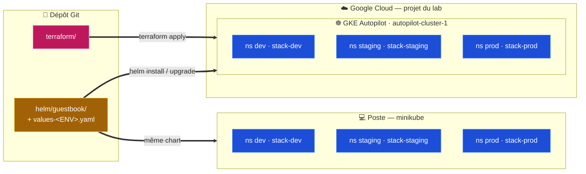
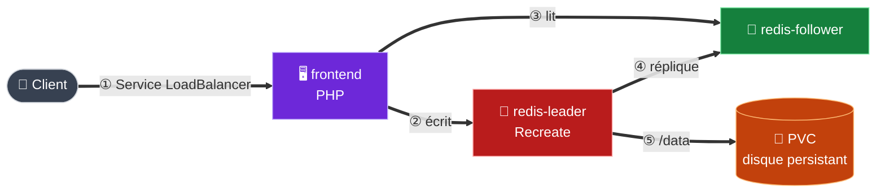

# Livre d'or Cloud — Projet 2

Application **Guestbook** : un site PHP et une base Redis (leader / followers).
Les données sont **persistantes**. L'application est packagée en **un chart Helm**.
Elle est déployée en **`dev` / `staging` / `prod`**, en local sur **minikube** et sur
**GKE Autopilot**. Le cluster GKE est créé par **Terraform**.

> **Pour qui ?** L'équipe qui reprend l'exploitation. Ce fichier est le **point d'entrée**.
> La documentation détaillée est dans [`docs/`](docs/README.md), une partie par fichier.

---

## 1. Présentation

| | |
|---|---|
| **Objectif** | Un livre d'or qui ne perd aucun message (disque persistant), déployé dans le cloud, reconstructible à tout moment |
| **Périmètre** | 3 environnements isolés (`dev`, `staging`, `prod`), en local (minikube) et sur GKE |
| **Terraform** | Crée le cluster GKE Autopilot `autopilot-cluster-1`. Rien dans le cluster |
| **Helm** | Installe l'application dans le cluster. Aucune ressource Google Cloud |

| Automatisé (en code) | Manuel |
|---|---|
| Création et destruction du cluster (`terraform apply` / `destroy`) | Démarrage du lab Google Skills (projet temporaire) |
| Déploiement, mise à jour, retour arrière de l'application (`helm`) | Acceptation des conditions d'utilisation, connexion `gcloud` |
| Configuration de l'application (ConfigMaps, `values-<ENV>.yaml`) | Remplissage de `terraform.tfvars` (projet et région du lab) |
| Création du disque persistant (PVC + StorageClass par défaut) | Activation de l'API GKE (`gcloud services enable container.googleapis.com`) |

---

## 2. Architecture



**Dans chaque namespace** (release `stack-<ENV>`) :



- **Où sont les données :** journal Redis (`appendonly.aof`) dans `/data` du leader → PVC →
  disque `standard` (minikube) ou disque persistant Google `standard-rwo` (GKE).
- Le frontend reçoit les adresses Redis par une ConfigMap. Chaque release parle à ses propres
  Services.

| | Local | Cloud |
|---|---|---|
| Accès au site | `LoadBalancer` + `minikube tunnel` | `ClusterIP` + `port-forward` (test), puis `LoadBalancer` (IP publique) |
| Port du site | dev 8080 · staging 8081 · prod 80 | idem |

---

## 3. Prérequis

| Outil | Version testée |
|---|---|
| Docker | 29.9.2 |
| minikube (driver Docker) | 1.38.1 (Kubernetes 1.35.1) |
| kubectl | 1.37.1 |
| Helm | 4.3.0 |
| Terraform | 1.15.9 |
| gcloud + `gke-gcloud-auth-plugin` | 591.0.0 + 0.5.10 |

Installation : [partie 1](docs/01-preparation-poste.md).

**Environnement cloud :** lab Google Skills
[« Deploying GKE Autopilot Clusters from Cloud Shell »](https://www.skills.google/paths/11/course_templates/2/labs/686877)
— **1 heure**, projet temporaire, compte avec le rôle `owner`.
Identifiants et `project_id` changent à chaque session.
Détail : [partie 7, étapes 7.3 et 7.4](docs/07-cluster-gke-terraform.md).

---

## 4. Déploiement de zéro

### Local

```bash
minikube start --driver=docker
kubectl apply -f k8s/namespaces.yaml
for env in dev staging prod; do
  helm install stack-$env helm/guestbook -n $env --create-namespace \
    -f helm/guestbook/values-$env.yaml
done
helm list -A                              # 3 releases deployed
minikube tunnel                           # terminal dédié
kubectl get svc -A | grep frontend        # EXTERNAL-IP + port
```

Détail : [partie 6](docs/06-environnements-dev-staging-prod.md).

### Cloud

```bash
# 1. Cluster (après connexion gcloud, partie 7)
cd terraform
cp terraform.tfvars.example terraform.tfvars      # project_id + region du lab
terraform init && terraform apply
terraform plan                                    # No changes

# 2. Connexion
eval "$(terraform output -raw get_credentials_command)"
kubectl config current-context                    # gke_…_autopilot-cluster-1
cd ..

# 3. dev : test puis ouverture
helm install stack-dev helm/guestbook -n dev --create-namespace \
  -f helm/guestbook/values-dev.yaml --set frontend.service.type=ClusterIP
kubectl port-forward svc/stack-dev-guestbook-frontend 8080:8080 -n dev
helm upgrade stack-dev helm/guestbook -n dev -f helm/guestbook/values-dev.yaml

# 4. staging et prod
for env in staging prod; do
  helm install stack-$env helm/guestbook -n $env --create-namespace \
    -f helm/guestbook/values-$env.yaml
done
kubectl get svc -A | grep LoadBalancer            # IP publiques
```

Détail : [partie 7](docs/07-cluster-gke-terraform.md) (Terraform : module, variables,
providers, outputs, ressources), [partie 8](docs/08-deploiement-gke.md) (déploiement).

---

## 5. Documentation

👉 **[Sommaire](docs/README.md)**

| Besoin | Où |
|---|---|
| Runbooks (mise à jour, rollback, configuration, volume, reconnexion, destruction…) | [Partie 9, §9.1](docs/09-exploitation.md) |
| Référence des valeurs Helm et des objets créés | [Partie 9, §9.2](docs/09-exploitation.md) |
| Documentation Terraform | [Partie 7](docs/07-cluster-gke-terraform.md) |
| Décisions techniques | [Partie 9, §9.3](docs/09-exploitation.md) |
| Dépannage et erreurs rencontrées | [Partie 9, §9.4](docs/09-exploitation.md) |
| Limites connues | [Partie 9, §9.5](docs/09-exploitation.md) |

## Organisation du dossier

```
Project-2/
├── README.md       → ce fichier : point d'entrée
├── docs/           → documentation de transfert (parties 0 à 9) + captures d'écran
├── k8s/            → manifestes Kubernetes bruts (référence lisible, base du chart)
├── helm/guestbook/ → chart Helm + values.yaml + values-dev / staging / prod.yaml
├── terraform/      → cluster GKE Autopilot
└── enonce/         → énoncé du projet, non modifié
```

L'énoncé : [`enonce/README.md`](enonce/README.md), avec les exigences
[Kubernetes](enonce/KUBERNETES.md), [Helm](enonce/HELM.md) et [Terraform](enonce/TERRAFORM.md).
