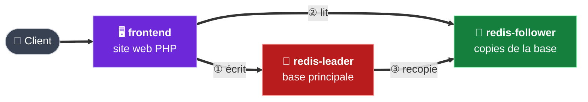
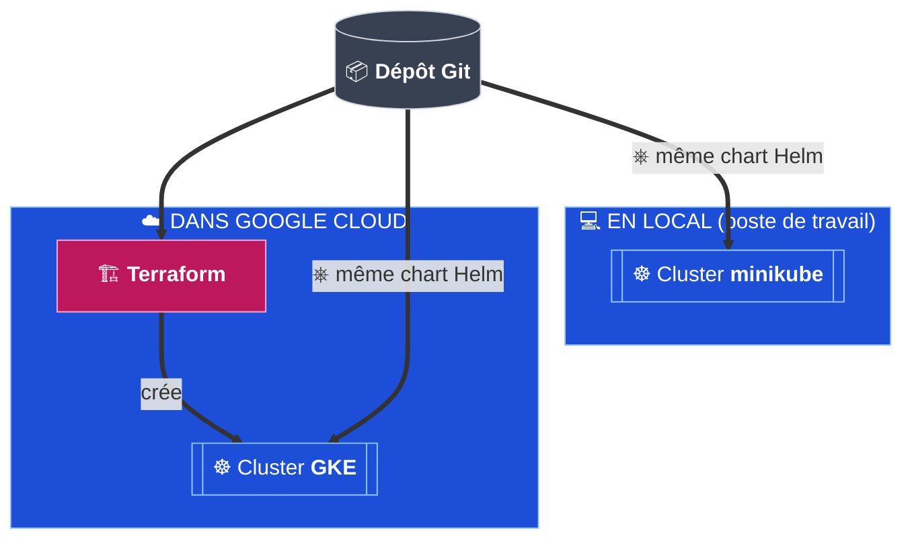

# Introduction

## Le contexte

**Cloud Hôtels** (une quarantaine d'hôtels) propose un **livre d'or numérique**.
En fin de séjour, le client écrit un message. Le message s'affiche dans le hall de l'hôtel.

Le premier prototype était installé à la main sur un poste.
Lors d'une démonstration, un redémarrage a **effacé tous les messages**.

## L'application

L'application est **Guestbook**, un exemple officiel de Kubernetes. Elle a **3 composants** :



| Composant | Rôle |
|---|---|
| **frontend** | Site web PHP : affiche et enregistre les messages |
| **redis-leader** | Base principale : reçoit **les écritures** |
| **redis-follower** | Copies de la base : servent **les lectures** |

## Les objectifs du projet

| # | Objectif | Comment |
|---|---|---|
| 1 | **Ne plus perdre aucun message** | La base écrit sur un disque persistant |
| 2 | **Héberger l'application dans le cloud** | Un cluster Kubernetes managé par Google (GKE) |
| 3 | **Créer le cluster en code** | Terraform |
| 4 | **3 environnements isolés** : `dev`, `staging`, `prod` | Un seul chart Helm, des réglages différents |
| 5 | **Pouvoir travailler en local** | minikube, avec le même chart que dans le cloud |
| 6 | **Aucun réglage écrit en dur** | ConfigMaps et fichiers de valeurs Helm |

> **Règle de base :** Terraform crée le cluster. Helm installe l'application dedans.
> Les deux outils ne se chevauchent jamais.

## Vue d'ensemble



Dans chaque cluster, l'application est installée **3 fois**, une par environnement (un namespace chacun) :

| Environnement | Rôle | Namespace | Installation Helm |
|---|---|---|---|
| **dev** | Tests des développeurs | `dev` | `stack-dev` |
| **staging** | Répétition avant la production | `staging` | `stack-staging` |
| **prod** | Utilisé par les clients | `prod` | `stack-prod` |

## Automatisé ou manuel

| ✅ Automatisé (code dans le dépôt) | ✋ Manuel (documenté ici) |
|---|---|
| Création du cluster GKE (Terraform) | Installation des outils sur le poste |
| Installation de l'application (Helm) | Ouverture d'une session de lab Google |
| Configuration des 3 environnements | Connexion au compte Google (`gcloud auth login`) |
| Mises à jour et retours arrière (Helm) | Saisie de l'ID du projet dans `terraform.tfvars` |

## Organisation du dépôt

```
Project-2/
├── docs/          → documentation et captures d'écran
├── k8s/           → manifestes Kubernetes de base (parties 3 et 4)
├── helm/          → chart Helm (parties 5 et 6)
└── terraform/     → création du cluster GKE (partie 7)
```

---

[🏠 Sommaire](README.md) · [Partie 1 — Préparer le poste ➡️](01-preparation-poste.md)
