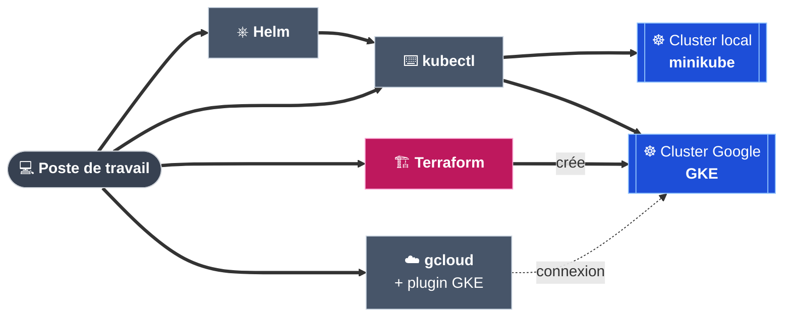

# Partie 1 — Préparer le poste de travail

## Objectif

Installer les outils nécessaires et démarrer un **cluster Kubernetes local**.
Ce cluster local permet de tout tester **gratuitement**, avant d'aller dans le cloud.

## Étape 1.1 — Les outils à installer

| Outil | À quoi il sert | Version testée |
|---|---|---|
| **Docker** | Fait tourner des conteneurs. minikube s'appuie dessus. | 29.9.2 |
| **minikube** | Un cluster Kubernetes sur le poste de travail | 1.38.1 |
| **kubectl** | La commande pour piloter un cluster Kubernetes | 1.37.1 |
| **Helm** | Installe l'application à partir du chart | 4.3.0 |
| **Terraform** | Crée le cluster dans Google Cloud | 1.15.9 |
| **gcloud** | La commande pour piloter Google Cloud | 591.0.0 |
| **gke-gcloud-auth-plugin** | Permet à kubectl de se connecter au cluster Google | 0.5.10 |



> Les commandes ci-dessous sont pour **Arch Linux**.
> Sur une autre distribution, utiliser le gestionnaire de paquets équivalent.

## Étape 1.2 — Installer kubectl, Helm, minikube et Terraform

```bash
sudo pacman -S --needed kubectl helm minikube terraform
```

L'option `--needed` évite de réinstaller un paquet déjà à jour.


> ⚠️ Des erreurs `404` peuvent apparaître pendant le téléchargement.
> Elles viennent d'un serveur miroir pas encore à jour. pacman essaie alors un autre miroir.
> Si l'installation se termine par `installing … 100%`, tout est correct.

**Vérification :**

```bash
kubectl version --client
helm version --short
minikube version --short
terraform version
```

## Étape 1.3 — Installer gcloud et le plugin GKE

Ces deux paquets viennent de l'**AUR** (dépôt communautaire d'Arch Linux).

```bash
yay -S google-cloud-cli google-cloud-cli-gke-gcloud-auth-plugin
```


> ⚠️ Bien vérifier le nom du plugin. Une faute de frappe donne l'erreur
> `No AUR package found` et le plugin n'est pas installé.

**Pourquoi ce plugin ?** Depuis Kubernetes 1.26, `kubectl` ne sait plus se connecter seul à un
cluster Google. Le plugin lui fournit un jeton d'accès.

**Vérification :**

```bash
gcloud version
gke-gcloud-auth-plugin --version
```

Résultat attendu :

```
Google Cloud SDK 591.0.0
...
gke-gcloud-auth-plugin 0.5.10
```

## Étape 1.4 — Démarrer le cluster local

```bash
minikube start --driver=docker
kubectl get nodes
```

`--driver=docker` : minikube crée son cluster **dans un conteneur Docker**.


**Résultat attendu :**

```
NAME       STATUS   ROLES           AGE   VERSION
minikube   Ready    control-plane   19s   v1.35.1
```

Le statut `Ready` signifie que le cluster est prêt.

**Ce que minikube a installé :**

| Élément | Valeur |
|---|---|
| Version de Kubernetes | 1.35.1 |
| Moteur de conteneurs dans minikube | Docker 29.2.1 |
| Ressources | 2 CPU, 3,9 Go de mémoire |
| Stockage | Une **StorageClass par défaut** (`standard`) : elle créera le disque de la base de données (partie 4) |

> **Les avertissements affichés ne sont pas bloquants :**
>
> - *« minikube 1.39.0 is available »* : une nouvelle version existe, elle n'est pas nécessaire.
> - *« kubectl is version 1.37.1 … Kubernetes 1.35.1 »* : les versions diffèrent un peu. Les
>   commandes utilisées dans ce projet fonctionnent. En cas de doute, utiliser
>   `minikube kubectl -- <commande>`.

## Étape 1.5 — Commandes utiles pour minikube

| Besoin | Commande |
|---|---|
| Démarrer le cluster | `minikube start` |
| Arrêter le cluster (les données sont gardées) | `minikube stop` |
| Voir l'état du cluster | `minikube status` |
| Supprimer complètement le cluster | `minikube delete` |
| Vérifier qu'on pilote bien minikube | `kubectl config current-context` → `minikube` |

## ✅ Récapitulatif de la partie 1

- [x] Les 7 outils sont installés et répondent.
- [x] Le cluster local minikube est démarré.
- [x] `kubectl get nodes` affiche `Ready`.

➡️ **Suite :** [Partie 2 — Constater le problème](02-constater-le-probleme.md).

---

[⬅️ Introduction](00-introduction.md) · [🏠 Sommaire](README.md) · [Partie 2 — Constater le problème ➡️](02-constater-le-probleme.md)
