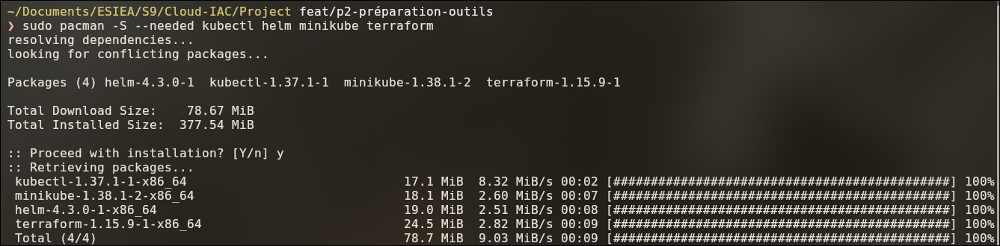
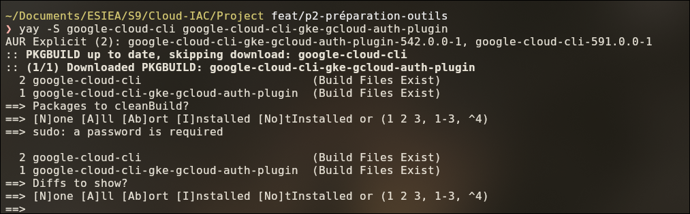
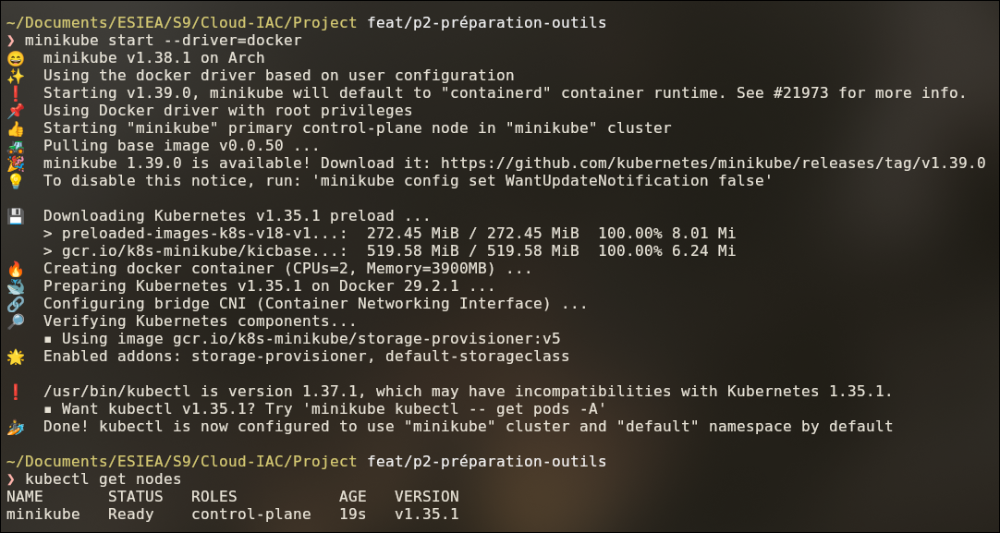

# Partie 1 — Préparer le poste de travail

## Objectif

Installer les outils et démarrer un **cluster Kubernetes local**.
Ce cluster sert à tout tester **gratuitement** avant le cloud.

## Étape 1.1 — Les outils à installer

| Outil | À quoi il sert | Version testée |
|---|---|---|
| **Docker** | Driver de minikube | 29.9.2 |
| **minikube** | Cluster local | 1.38.1 |
| **kubectl** | Pilotage des clusters | 1.37.1 |
| **Helm** | Installation du chart | 4.3.0 |
| **Terraform** | Création du cluster GKE | 1.15.9 |
| **gcloud** | Pilotage de Google Cloud | 591.0.0 |
| **gke-gcloud-auth-plugin** | Authentification de kubectl sur GKE | 0.5.10 |


> Les commandes ci-dessous sont pour **Arch Linux**. Ailleurs, utiliser le gestionnaire de paquets équivalent.

## Étape 1.2 — Installer kubectl, Helm, minikube et Terraform

```bash
sudo pacman -S --needed kubectl helm minikube terraform
```



> ⚠️ Des erreurs `404` peuvent apparaître : un miroir n'est pas à jour, pacman en essaie un autre.
> Si l'installation se termine par `installing … 100%`, tout est correct.

**Vérification :**

```bash
kubectl version --client
helm version --short
minikube version --short
terraform version
```

## Étape 1.3 — Installer gcloud et le plugin GKE

Ces deux paquets viennent de l'**AUR**.

```bash
yay -S google-cloud-cli google-cloud-cli-gke-gcloud-auth-plugin
```



> ⚠️ Une faute de frappe dans le nom du plugin donne `No AUR package found`.

Depuis Kubernetes 1.26, `kubectl` a besoin de ce plugin pour s'authentifier sur GKE.

**Vérification :**

```bash
gcloud version
gke-gcloud-auth-plugin --version
```

Résultat attendu :

```
Google Cloud SDK 591.0.0
...
gke-gcloud-auth-plugin 0.5.10
```

## Étape 1.4 — Démarrer le cluster local

```bash
minikube start --driver=docker
kubectl get nodes
```



**Résultat attendu :**

```
NAME       STATUS   ROLES           AGE   VERSION
minikube   Ready    control-plane   19s   v1.35.1
```

**Ce que minikube a installé :**

| Élément | Valeur |
|---|---|
| Version de Kubernetes | 1.35.1 |
| Moteur de conteneurs dans minikube | Docker 29.2.1 |
| Ressources | 2 CPU, 3,9 Go de mémoire |
| Stockage | **StorageClass par défaut** `standard` (utilisée pour le disque Redis, partie 4) |

> **Avertissements non bloquants :**
>
> - *« minikube 1.39.0 is available »* : la mise à jour n'est pas nécessaire.
> - *« kubectl is version 1.37.1 … Kubernetes 1.35.1 »* : les commandes du projet fonctionnent.
>   En cas de doute, utiliser `minikube kubectl -- <commande>`.

## Étape 1.5 — Commandes utiles pour minikube

| Besoin | Commande |
|---|---|
| Démarrer le cluster | `minikube start` |
| Arrêter le cluster (données gardées) | `minikube stop` |
| Voir l'état du cluster | `minikube status` |
| Supprimer complètement le cluster | `minikube delete` |
| Vérifier qu'on pilote bien minikube | `kubectl config current-context` → `minikube` |

## ✅ Récapitulatif de la partie 1

- [x] Les 7 outils sont installés et répondent.
- [x] Le cluster local minikube est démarré.
- [x] `kubectl get nodes` affiche `Ready`.

➡️ **Suite :** [Partie 2 — Constater le problème](02-constater-le-probleme.md).

---

[⬅️ Introduction](00-introduction.md) · [🏠 Sommaire](README.md) · [Partie 2 — Constater le problème ➡️](02-constater-le-probleme.md)
