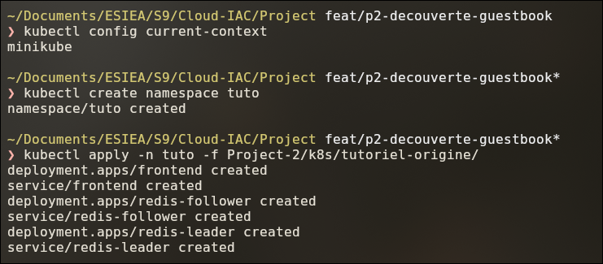
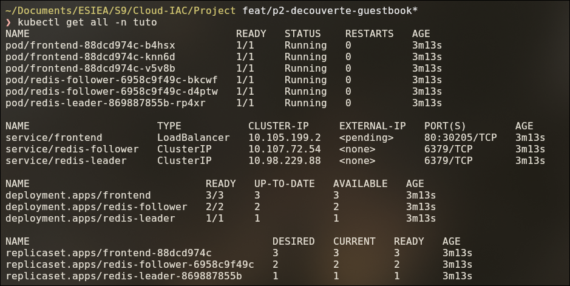
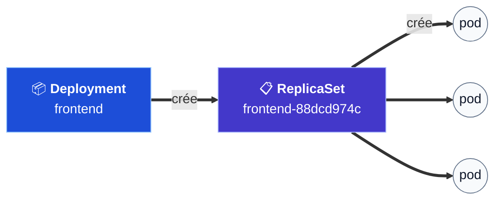
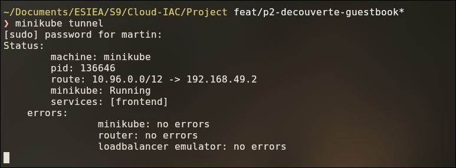
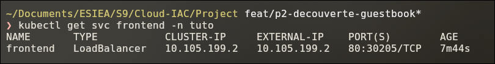
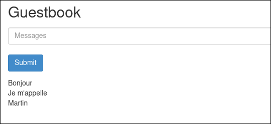
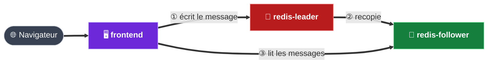
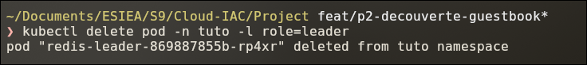
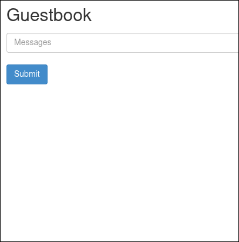
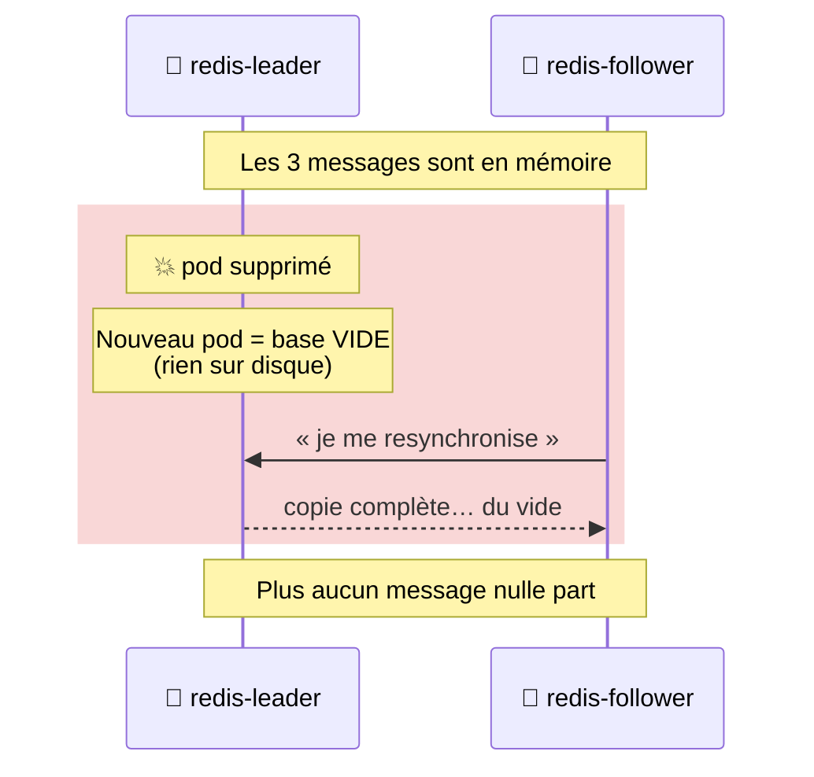

# Partie 2 — Constater le problème

## Objectif

Installer l'application **telle qu'elle était à l'origine**, puis **reproduire le problème du
client** : après un redémarrage de la base, tous les messages disparaissent.

C'est l'état « **avant** ». Les parties suivantes corrigent ce qu'on observe ici.

> Cette partie se fait sur le **cluster local** (minikube), préparé en
> [partie 1](01-preparation-poste.md).

---

## Étape 2.1 — Les fichiers d'origine

Les fichiers du tutoriel officiel sont rangés **sans aucune modification** dans le dépôt :

```
Project-2/k8s/tutoriel-origine/
├── README.md                        → origine des fichiers (source, version, licence)
├── frontend-deployment.yaml         → le site web (3 copies)
├── frontend-service.yaml            → l'accès au site web
├── redis-leader-deployment.yaml     → la base principale (1 copie)
├── redis-leader-service.yaml        → le nom réseau de la base principale
├── redis-follower-deployment.yaml   → les copies de la base (2 copies)
└── redis-follower-service.yaml      → le nom réseau des copies
```

Ils servent à deux choses :

1. reproduire le problème ;
2. comparer avec nos fichiers améliorés (parties 3 et 4).

> ⚠️ Ces fichiers ne sont **pas** utilisés pour `dev`, `staging` ou `prod`.

### Trois mots à connaître

| Mot | Définition simple |
|---|---|
| **Pod** | Un programme qui tourne dans le cluster (ex. : la base de données) |
| **Deployment** | La consigne « garde ce programme allumé ». Si le pod disparaît, il en recrée un. |
| **Service** | Un nom et une adresse fixes pour joindre un pod, même s'il est recréé |

---

## Étape 2.2 — Installer l'application d'origine

On l'installe dans un **namespace** à part, `tuto`. Un namespace est un espace isolé : tout ce
qui est dedans se supprime en une commande à la fin.

```bash
kubectl config current-context        # doit afficher : minikube
kubectl create namespace tuto
kubectl apply -n tuto -f Project-2/k8s/tutoriel-origine/
```

| Commande | Ce qu'elle fait |
|---|---|
| `kubectl config current-context` | Vérifie qu'on travaille bien sur le cluster **local** |
| `kubectl create namespace tuto` | Crée l'espace isolé `tuto` |
| `kubectl apply -n tuto -f <dossier>` | Crée tous les objets décrits dans les fichiers `.yaml` du dossier |



**Résultat attendu :** 6 objets créés (3 Deployments et 3 Services).

---

## Étape 2.3 — Vérifier que tout tourne

```bash
kubectl get all -n tuto
```



**À vérifier :**

| Élément | Attendu |
|---|---|
| Pods | 6 pods `Running`, `READY 1/1` : 3 `frontend`, 2 `redis-follower`, 1 `redis-leader` |
| Service `frontend` | Type `LoadBalancer`, `EXTERNAL-IP <pending>` (normal à ce stade) |
| Services `redis-*` | Type `ClusterIP` : joignables **seulement** depuis l'intérieur du cluster |

**Comment les objets s'enchaînent :**



Le Deployment crée un ReplicaSet, qui crée les pods. D'où les noms en plusieurs morceaux :
`frontend-88dcd974c-b4hsx` = nom du Deployment + identifiant du ReplicaSet + identifiant du pod.

---

## Étape 2.4 — Accéder au site web

Le Service `frontend` est de type `LoadBalancer` : il attend une adresse externe.
Dans le cloud, Google la fournit. **En local, c'est `minikube tunnel` qui joue ce rôle.**

Dans un **terminal dédié**, à laisser ouvert :

```bash
minikube tunnel
```

La commande demande le mot de passe `sudo` (elle modifie le réseau du poste).



**À vérifier :** `services: [frontend]` et `no errors` sur les 3 lignes.

Dans un **autre terminal**, récupérer l'adresse du site :

```bash
kubectl get svc frontend -n tuto
```



L'adresse est dans la colonne **`EXTERNAL-IP`** (ici `10.105.199.2`).

> 💡 **L'adresse dépend du système :**
>
> | Système | `EXTERNAL-IP` |
> |---|---|
> | Linux | Une IP du cluster (ex. `10.105.199.2`) |
> | macOS / Windows (Docker Desktop) | `127.0.0.1` |

Ouvrir **http://10.105.199.2** dans le navigateur, puis écrire quelques messages :



**Ce qui se passe derrière :**



---

## Étape 2.5 — Reproduire le problème

On supprime le pod de la base principale. Cela simule une panne, un redémarrage ou une mise à
jour.

```bash
kubectl delete pod -n tuto -l role=leader
```

`-l role=leader` choisit le pod par son **étiquette** (label), sans avoir à taper son nom complet.



Le Deployment remarque qu'il manque un pod et **en recrée un neuf**.
On attend qu'il soit prêt :

```bash
kubectl get pods -n tuto -w      # Ctrl+C quand le nouveau redis-leader est "Running"
```

Puis on **recharge la page** :



### 💥 Résultat : tous les messages ont disparu

C'est **exactement** le problème rencontré par le client.

---

## Pourquoi les messages disparaissent



1. Redis garde les messages **en mémoire uniquement**.
2. Le pod est recréé **à partir de l'image** : il démarre avec une mémoire vide.
3. Les copies (`redis-follower`) se resynchronisent sur la nouvelle base… et deviennent vides
   elles aussi.

> **Conclusion :** il faut que la **base principale** retrouve ses données au redémarrage.
> Il lui faut un **disque qui survit au pod**. C'est l'objet de la partie 4.

---

## Ce qui manque aux fichiers d'origine

En lisant les fichiers du tutoriel, on relève 6 points à corriger.
Les numéros de ligne renvoient aux fichiers de `Project-2/k8s/tutoriel-origine/`.

| # | Ce qui manque | Où on le voit | Risque | Corrigé en |
|---|---|---|---|---|
| 1 | Aucune persistance des données | `redis-leader-deployment.yaml`, l. 37-45 | **Perte de tous les messages** au redémarrage | Partie 4 |
| 2 | Aucun contrôle de santé | Les 3 `*-deployment.yaml`, bloc `containers` | Un programme bloqué reçoit quand même du trafic | Partie 3 |
| 3 | Pas de limites de ressources | Les 3 `*-deployment.yaml`, bloc `resources` | Un programme peut consommer toute la mémoire du nœud | Partie 3 |
| 4 | Réglage écrit dans le Deployment | `frontend-deployment.yaml`, l. 36-38 | Configuration mélangée au code | Partie 3 (ConfigMap) |
| 5 | Étiquettes non standard | Tous les fichiers, bloc `labels` | Objets difficiles à repérer et à filtrer | Partie 3 |
| 6 | Même sélecteur pour leader et followers | `redis-leader-deployment.yaml` l. 27-29 et `redis-follower-deployment.yaml` l. 27-29 | Confusion entre la base principale et les copies | Partie 3 |

### ① Aucune persistance — `redis-leader-deployment.yaml`

```yaml
    spec:
      containers:
      - name: leader
        image: "docker.io/redis:6.0.5"
        resources:
          requests:
            cpu: 100m
            memory: 100Mi
        ports:
        - containerPort: 6379
      # ❌ pas de "volumeMounts" : aucun disque branché sur /data
      # ❌ pas de "volumes" ni de PersistentVolumeClaim
      # ❌ pas de fichier redis.conf : Redis n'écrit rien sur disque
```

Le conteneur n'a **aucun disque**. Tout est en mémoire, donc perdu quand le pod est recréé.

### ② Aucun contrôle de santé — les 3 Deployments

Exemple dans `frontend-deployment.yaml` :

```yaml
      containers:
      - name: php-redis
        image: us-docker.pkg.dev/google-samples/containers/gke/gb-frontend:v5
        ...
        ports:
        - containerPort: 80
        # ❌ pas de "readinessProbe" : Kubernetes ne sait pas si le pod est prêt
        # ❌ pas de "livenessProbe"  : un programme bloqué n'est jamais redémarré
```

Même constat dans `redis-leader-deployment.yaml` et `redis-follower-deployment.yaml`.

### ③ Pas de limites de ressources — les 3 Deployments

```yaml
        resources:
          requests:          # ✅ ce qui est réservé
            cpu: 100m
            memory: 100Mi
                             # ❌ pas de "limits" : aucun plafond
```

Les `requests` réservent des ressources, mais **sans `limits`**, rien n'empêche un programme
de consommer toute la mémoire ou tout le processeur du nœud.

### ④ Réglage écrit dans le Deployment — `frontend-deployment.yaml`, l. 36-38

```yaml
        env:
        - name: GET_HOSTS_FROM      # ❌ réglage écrit directement dans le Deployment
          value: "dns"
```

Pour changer ce réglage, il faut modifier le Deployment lui-même. Les réglages doivent être
dans un objet séparé : une **ConfigMap**.

### ⑤ Étiquettes non standard — tous les fichiers

```yaml
  labels:
    app: redis          # ❌ noms "maison"
    role: leader
    tier: backend
```

Kubernetes recommande des étiquettes standard : `app.kubernetes.io/name`,
`app.kubernetes.io/component`, `app.kubernetes.io/part-of`… Elles sont reconnues par les
outils (Helm, tableaux de bord) et identiques d'un projet à l'autre.

### ⑥ Même sélecteur pour leader et followers

`redis-leader-deployment.yaml`, l. 27-29 :

```yaml
  selector:
    matchLabels:
      app: redis        # ❌ ne précise pas "leader"
```

`redis-follower-deployment.yaml`, l. 27-29 :

```yaml
  selector:
    matchLabels:
      app: redis        # ❌ exactement le même sélecteur
```

Le **sélecteur** indique à un Deployment quels pods lui appartiennent. Ici, les deux
Deployments revendiquent les mêmes pods `app: redis` : leader et copies ne sont pas
clairement séparés. Le sélecteur doit inclure le rôle (`component: redis-leader` /
`redis-follower`).

---

## Étape 2.6 — Nettoyer

```bash
kubectl delete namespace tuto
```

Supprime le namespace **et tout ce qu'il contient**. Fermer ensuite le terminal de
`minikube tunnel` (`Ctrl+C`).

---

## ✅ Récapitulatif de la partie 2

- [x] L'application d'origine a été installée dans le namespace `tuto`.
- [x] Le site est accessible grâce à `minikube tunnel`.
- [x] Le problème est reproduit : **la suppression du pod leader efface tous les messages**.
- [x] La cause est identifiée : Redis ne garde ses données qu'en mémoire.
- [x] La liste des corrections à apporter est établie.

➡️ **Suite :** [Partie 3 — Les manifestes Kubernetes](03-manifestes-kubernetes.md).

---

[⬅️ Partie 1 — Préparer le poste](01-preparation-poste.md) · [🏠 Sommaire](README.md) · [Partie 3 — Les manifestes Kubernetes ➡️](03-manifestes-kubernetes.md)
