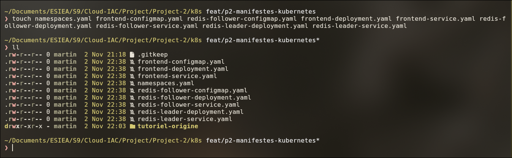
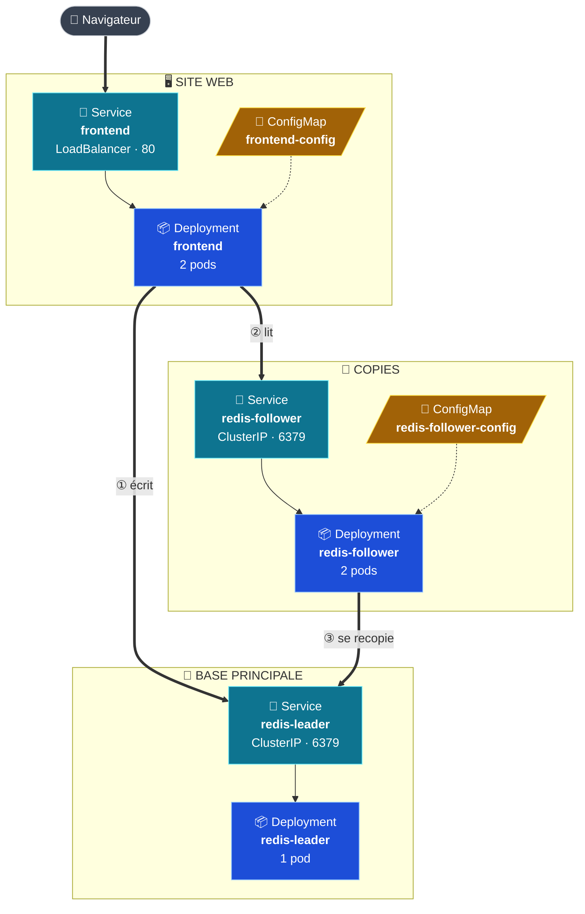
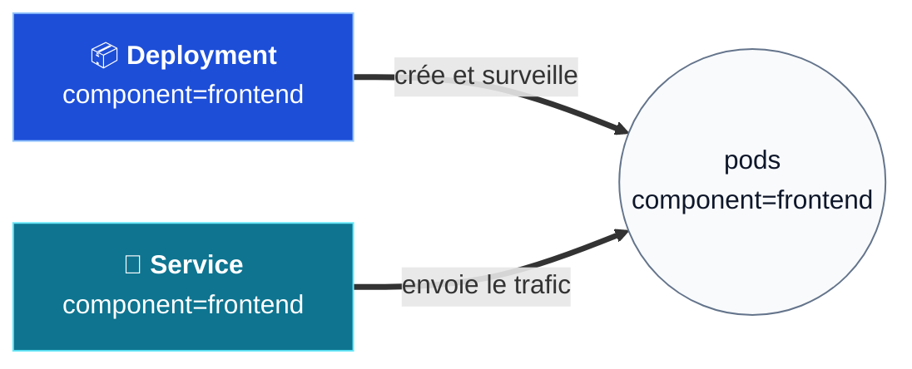
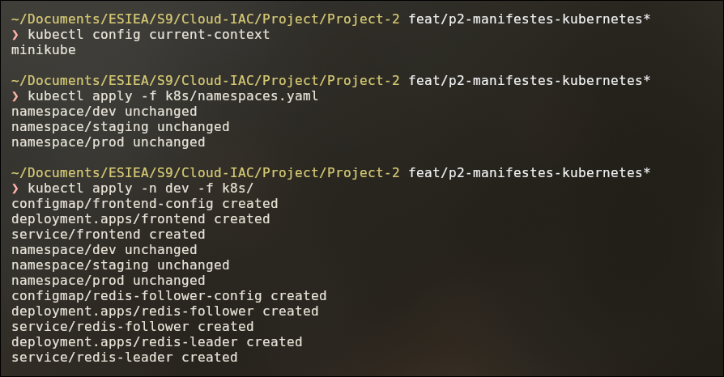
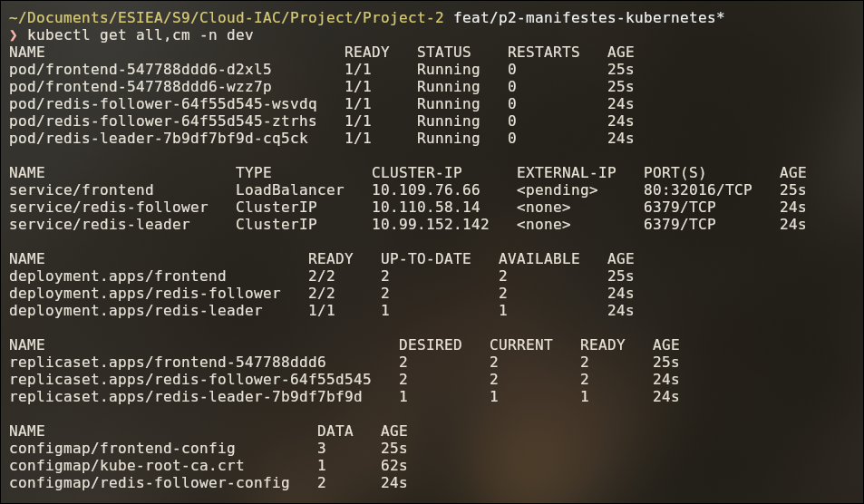
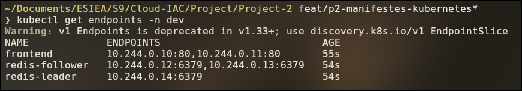
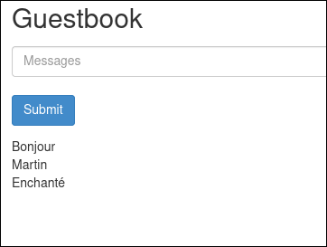

# Partie 3 — Les manifestes Kubernetes

## Objectif

Réécrire les fichiers du tutoriel pour corriger les défauts relevés en
[partie 2](02-constater-le-probleme.md) :

- étiquettes standard ;
- réglages dans des **ConfigMaps** ;
- **contrôles de santé** sur chaque programme ;
- **limites de ressources**.

On les teste sur le cluster local (minikube), dans le namespace `dev`.

> La **persistance** (disque pour Redis) est traitée en partie 4. À la fin de cette partie,
> l'application perd encore ses messages au redémarrage.

---

## Étape 3.1 — Les fichiers

Un fichier par objet Kubernetes, nommé `<brique>-<type>.yaml` :

```
Project-2/k8s/
├── namespaces.yaml                  → les 3 environnements : dev, staging, prod
├── frontend-configmap.yaml          → réglages du site web
├── frontend-deployment.yaml         → le site web (2 copies)
├── frontend-service.yaml            → l'accès au site web
├── redis-follower-configmap.yaml    → réglages des copies Redis
├── redis-follower-deployment.yaml   → les copies Redis (2 copies)
├── redis-follower-service.yaml      → l'adresse des copies
├── redis-leader-deployment.yaml     → la base principale (1 seule)
├── redis-leader-service.yaml        → l'adresse de la base principale
└── tutoriel-origine/                → fichiers d'origine (partie 2), non utilisés
```



### Ce qui est créé dans chaque environnement



Le même contenu est créé dans chaque namespace (`dev`, `staging`, `prod`). La flèche pointillée
signifie « fournit ses réglages à ».

---

## Étape 3.2 — Les choix techniques

### Les étiquettes (labels)

Chaque objet porte 4 étiquettes standard :

| Étiquette | Valeur | Sens |
|---|---|---|
| `app.kubernetes.io/name` | `guestbook` | L'application |
| `app.kubernetes.io/instance` | `guestbook` | L'installation (deviendra `stack-dev`, etc. avec Helm) |
| `app.kubernetes.io/component` | `frontend` / `redis-leader` / `redis-follower` | La brique |
| `app.kubernetes.io/part-of` | `livre-or-cloud` | Le projet |

Les **sélecteurs** (Deployment → pods, Service → pods) utilisent `name`, `instance` et
`component`.



> ✅ **Correction du tutoriel :** leader et copies avaient le même sélecteur (`app: redis`).
> Ils sont maintenant séparés par `component`.

### Comment le site trouve la base : les ConfigMaps

Le code du site (PHP) lit le réglage `GET_HOSTS_FROM` :

- avec `dns` (tutoriel), les noms `redis-leader` et `redis-follower` sont **écrits en dur**
  dans le programme ;
- avec `env` (**notre choix**), il lit `REDIS_LEADER_SERVICE_HOST` et
  `REDIS_FOLLOWER_SERVICE_HOST`.

On fournit ces variables dans les ConfigMaps :

| ConfigMap | Réglages | Utilisée par |
|---|---|---|
| `frontend-config` | `GET_HOSTS_FROM=env`, `REDIS_LEADER_SERVICE_HOST=redis-leader`, `REDIS_FOLLOWER_SERVICE_HOST=redis-follower` | Le site : où **écrire**, où **lire** |
| `redis-follower-config` | `GET_HOSTS_FROM=env`, `REDIS_LEADER_SERVICE_HOST=redis-leader` | Les copies : **qui copier** |

**Pourquoi :** les noms des Services ne sont plus figés dans le programme. Avec Helm
(partie 5), on les change en modifiant une seule valeur.

> ⚠️ Le **port 6379** reste écrit en dur dans le programme : les Services Redis doivent garder
> ce port.

### Les contrôles de santé (probes)

| | readinessProbe | livenessProbe |
|---|---|---|
| Si échec | Plus de trafic envoyé au pod | Le pod est redémarré |
| 1er test | après 5 s | après 15 s |
| Fréquence | toutes les 10 s | toutes les 20 s |

| Programme | Test utilisé | Pourquoi |
|---|---|---|
| frontend | Demande de la page `/` (`httpGet` sur le port `http`) | Vérifie que le site répond |
| redis-leader / redis-follower | `redis-cli ping \| grep -q PONG` (`exec`) | Vérifie que Redis **répond vraiment**, pas seulement que le port est ouvert |

Le reste garde les valeurs par défaut (1 s pour répondre, 3 échecs avant d'agir). La liveness
est **plus patiente** que la readiness : redémarrer coûte plus cher que retirer du trafic.

### Les ressources

| | CPU | Mémoire | Sens |
|---|---|---|---|
| `requests` | 100m (0,1 processeur) | 128 Mi | **Réservé** au pod |
| `limits` | 250m (0,25 processeur) | 256 Mi | **Plafond** : au-delà, CPU ralenti et pod arrêté s'il dépasse la mémoire |

Les `requests` reprennent les valeurs du tutoriel (mémoire légèrement augmentée). Les `limits`
laissent une marge d'environ ×2,5 pour les pics.

### Les Services

| Service | Type | Port | Accessible depuis |
|---|---|---|---|
| `frontend` | `LoadBalancer` | 80 → `http` | **L'extérieur** (via `minikube tunnel` en local) |
| `redis-leader` | `ClusterIP` | 6379 → `redis` | L'intérieur du cluster uniquement |
| `redis-follower` | `ClusterIP` | 6379 → `redis` | L'intérieur du cluster uniquement |

La base de données n'est pas exposée hors du cluster.

### Avant / après

| Tutoriel d'origine | Nos manifestes |
|---|---|
| Étiquettes `app`, `role`, `tier` | Étiquettes standard `app.kubernetes.io/*` |
| Même sélecteur pour leader et copies | Sélecteurs séparés par `component` |
| `GET_HOSTS_FROM` écrit dans le Deployment | Réglages dans des **ConfigMaps** |
| Aucun contrôle de santé | **readiness + liveness** partout |
| `requests` seulement | `requests` **+ `limits`** |
| Ports sans nom | Ports nommés `http` et `redis` |
| Pas de commentaire | Un commentaire en tête de chaque fichier |

---

## Étape 3.3 — Installer dans `dev`

Depuis le dossier `Project-2/` :

```bash
kubectl config current-context           # doit afficher : minikube
kubectl apply -f k8s/namespaces.yaml     # crée dev, staging, prod
kubectl apply -n dev -f k8s/             # installe l'application dans dev
```



- Aucun fichier ne fixe de namespace : on le choisit avec `-n dev`. Les mêmes fichiers servent
  pour `staging` et `prod`.
- Le sous-dossier `tutoriel-origine/` n'est pas lu (`-f` sur un dossier n'est pas récursif).

---

## Étape 3.4 — Vérifier

### Tous les objets sont là

```bash
kubectl get all,cm -n dev
```



| À vérifier | Attendu |
|---|---|
| Pods | 5 pods `Running`, `READY 1/1` (2 frontend, 2 redis-follower, 1 redis-leader) |
| `READY 1/1` | La readiness probe est validée |
| ConfigMaps | `frontend-config` (3 réglages) et `redis-follower-config` (2 réglages) |

> `kube-root-ca.crt` est créée automatiquement par Kubernetes. Ce n'est pas la nôtre.

### Chaque Service trouve ses pods

```bash
kubectl get endpoints -n dev
```



Une ligne `<none>` signifierait que le sélecteur ne correspond à aucun pod.

| Service | Nombre d'adresses | Correspond à |
|---|---|---|
| `frontend` | 2 | Les 2 pods du site |
| `redis-follower` | 2 | Les 2 copies |
| `redis-leader` | 1 | La base principale |

> L'avertissement `v1 Endpoints is deprecated` est sans conséquence. Commande équivalente :
> `kubectl get endpointslices -n dev`.

### Autres vérifications utiles

```bash
# Contrôles de santé et ressources de chaque programme
kubectl describe deploy -n dev | grep -E "Liveness|Readiness|Limits|Requests" -A2

# Réglages reçus par le site
kubectl exec -n dev deploy/frontend -- env | grep -E "GET_HOSTS|REDIS_"

# Les copies sont bien connectées au leader (doit afficher : up)
kubectl exec -n dev deploy/redis-follower -- redis-cli INFO replication | grep master_link_status
```

### L'application fonctionne

Avec `minikube tunnel` ouvert dans un autre terminal :

```bash
kubectl get svc frontend -n dev          # colonne EXTERNAL-IP
```

Ouvrir `http://<EXTERNAL-IP>` et écrire des messages :



Les messages s'enregistrent et s'affichent : le site écrit sur `redis-leader` et lit sur
`redis-follower` grâce aux ConfigMaps.

---

## ✅ Récapitulatif de la partie 3

- [x] 9 fichiers propres et commentés dans `Project-2/k8s/`.
- [x] Étiquettes standard, sélecteurs séparés pour leader et copies.
- [x] Réglages dans 2 ConfigMaps.
- [x] readiness + liveness et requests + limits sur chaque programme.
- [x] Application installée et fonctionnelle dans `dev`.
- [ ] Persistance des messages → [partie 4](04-persistance-des-donnees.md).

➡️ **Suite :** [Partie 4 — La persistance des données](04-persistance-des-donnees.md).

---

[⬅️ Partie 2 — Constater le problème](02-constater-le-probleme.md) · [🏠 Sommaire](README.md) · [Partie 4 — La persistance des données ➡️](04-persistance-des-donnees.md)
