# Partie 4 — La persistance des données

## Objectif

Corriger le problème constaté en [partie 2](02-constater-le-probleme.md) : **plus aucun message
ne doit être perdu** quand la base principale (`redis-leader`) redémarre.

C'est **l'exigence n°1 du client**.

Il faut **deux choses en même temps**, l'une ne sert à rien sans l'autre :

| Pièce | Rôle | Sans elle… |
|---|---|---|
| ① **Un disque persistant** (PVC) monté sur `/data` | Garder les fichiers même si le pod meurt | Redis écrit dans le conteneur, qui disparaît avec le pod |
| ② **Un réglage Redis** (`redis.conf`) | Dire à Redis d'écrire chaque message sur ce disque | Redis a un disque mais garde tout en mémoire |

Et un troisième réglage pour protéger le disque : la stratégie **`Recreate`**.

---

## Étape 4.1 — Comment ça marche

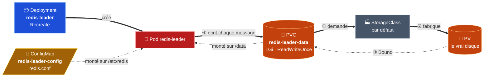

### Le disque : PVC, StorageClass, PV

| Objet | Rôle |
|---|---|
| **PVC** (*PersistentVolumeClaim*) | La **demande** de disque : « 1 Go, branchable sur un seul nœud » |
| **StorageClass** | Le **type de stockage** qui crée le disque automatiquement |
| **PV** (*PersistentVolume*) | Le **disque réellement créé** |

Le PVC est un objet **indépendant du pod** : si le pod est supprimé, le PVC et son disque
restent. Le nouveau pod rebranche le même disque.

| Cluster | StorageClass par défaut | Disque créé |
|---|---|---|
| minikube | `standard` | Un dossier sur la machine minikube |
| GKE | `standard-rwo` | Un disque persistant Google |

### Le réglage Redis : le mode AOF

AOF (*Append Only File*) = un **journal** : Redis ajoute **chaque écriture** à la fin du fichier
`/data/appendonly.aof`. Au redémarrage, il **relit le journal** et retrouve tous les messages.

| Mode | Principe | Perte maximale | Utilisé |
|---|---|---|---|
| **AOF** | Journal de chaque écriture, enregistré sur disque toutes les secondes | ~1 seconde | ✅ |
| RDB | Photo complète de la base, de temps en temps | Plusieurs minutes | ❌ photos automatiques désactivées |

---

## Étape 4.2 — Les fichiers

Deux fichiers ajoutés, un modifié, dans `Project-2/k8s/` :

```
Project-2/k8s/
├── redis-leader-configmap.yaml    → NOUVEAU : le fichier redis.conf
├── redis-leader-pvc.yaml          → NOUVEAU : la demande de disque
└── redis-leader-deployment.yaml   → MODIFIÉ : Recreate + args + volumes
```

### `redis-leader-configmap.yaml` — le réglage Redis

```yaml
data:
  redis.conf: |
    dir /data          # Redis écrit ses fichiers sur le disque persistant
    appendonly yes     # mode AOF : chaque écriture est journalisée
```

### `redis-leader-pvc.yaml` — le disque

```yaml
spec:
  accessModes:
    - ReadWriteOnce    # branché sur un seul nœud à la fois
  resources:
    requests:
      storage: 1Gi     # quelques Ko de messages : large marge
```

### `redis-leader-deployment.yaml` — les 4 ajouts

```yaml
spec:
  strategy:
    type: Recreate                                    # ①
  template:
    spec:
      containers:
        - name: leader
          args: ["redis-server", "/etc/redis/redis.conf"]   # ②
          volumeMounts:                               # ③ OÙ dans le conteneur
            - name: data
              mountPath: /data
            - name: config
              mountPath: /etc/redis
              readOnly: true
      volumes:                                        # ④ D'OÙ viennent les volumes
        - name: data
          persistentVolumeClaim:
            claimName: redis-leader-data
        - name: config
          configMap:
            name: redis-leader-config
```

| Ajout | Rôle |
|---|---|
| ① `strategy: Recreate` | Arrêter l'ancien Redis **avant** de lancer le nouveau (voir étape 4.3) |
| ② `args` | Démarrer Redis **avec notre `redis.conf`** |
| ③ `volumeMounts` | Le disque apparaît sur `/data`, le réglage sur `/etc/redis` (lecture seule) |
| ④ `volumes` | `data` vient du PVC, `config` vient de la ConfigMap |

`volumes` et `volumeMounts` sont reliés par leur **nom** (`data`, `config`).

---

## Étape 4.3 — Pourquoi la stratégie `Recreate`

Le disque est en mode **`ReadWriteOnce`** : il ne peut être branché qu'à **un seul nœud** à la
fois.

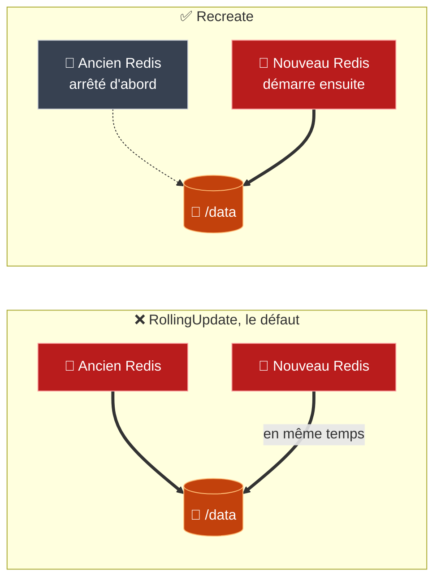

| | `RollingUpdate` (défaut) | `Recreate` (notre choix) |
|---|---|---|
| Ordre | Nouveau pod **puis** arrêt de l'ancien | Arrêt de l'ancien **puis** nouveau pod |
| Pods sur 2 nœuds différents | Le nouveau reste bloqué : le disque est déjà attaché ailleurs | Pas de conflit |
| Pods sur le même nœud | **Deux Redis écrivent dans les mêmes fichiers** → base corrompue | Un seul Redis à la fois |
| Disponibilité | Pas de coupure | Quelques secondes sans écriture possible |

**Compromis assumé :** quelques secondes sans écriture valent mieux qu'une base corrompue.

Le frontend et les copies (`redis-follower`) restent en `RollingUpdate` : ils n'ont pas de
disque.

---

## Étape 4.4 — Installer dans `dev`

```bash
kubectl apply -n dev -f k8s/
kubectl get pvc -n dev
kubectl rollout status deploy/redis-leader -n dev
```

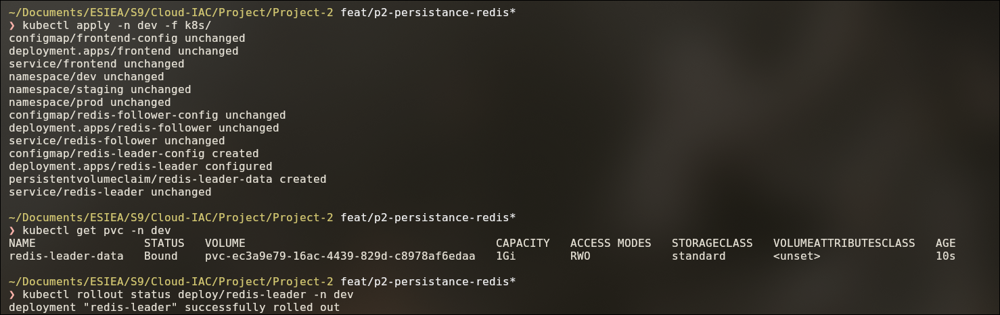

| À vérifier | Attendu |
|---|---|
| `configmap/redis-leader-config` | `created` |
| `persistentvolumeclaim/redis-leader-data` | `created` |
| `deployment.apps/redis-leader` | `configured` (modifié) |
| Le reste | `unchanged` : le site et les copies ne sont pas touchés |
| PVC | `Bound`, `1Gi`, `RWO`, StorageClass `standard` |

> `STORAGECLASS = standard` alors qu'on n'a **pas** écrit de `storageClassName` : c'est la
> preuve que la classe **par défaut** est utilisée.

---

## Étape 4.5 — Le test de non-perte

C'est le test imposé par le client. On refait **exactement** la manipulation de la partie 2.

### Préparer

Dans un terminal dédié, laissé ouvert pendant tout le test :

```bash
minikube tunnel
```

Dans un autre terminal :

```bash
kubectl get svc frontend -n dev          # lire la colonne EXTERNAL-IP
```

Ouvrir `http://<EXTERNAL-IP>`.

### 1. Écrire 3 messages

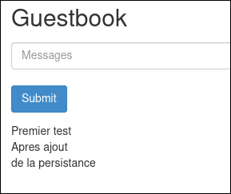

```bash
kubectl exec -n dev deploy/redis-leader -- redis-cli GET guestbook
```

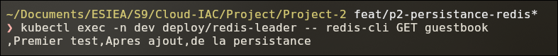

Tous les messages sont dans **une seule clé** Redis, `guestbook`, séparés par des virgules. La
virgule au début est normale : l'application ajoute `,message` à la fin d'une valeur vide au
départ.

### 2. Vérifier que Redis écrit sur le disque

```bash
kubectl exec -n dev deploy/redis-leader -- redis-cli CONFIG GET dir
kubectl exec -n dev deploy/redis-leader -- redis-cli CONFIG GET appendonly
kubectl exec -n dev deploy/redis-leader -- ls -l /data
```

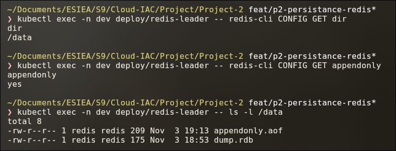

| Résultat | Signification |
|---|---|
| `dir` → `/data` | Redis écrit sur le disque persistant : `redis.conf` est bien utilisé |
| `appendonly` → `yes` | Le journal AOF est actif |
| `appendonly.aof` | Le journal, qui contient les messages |
| `dump.rdb` | Une copie complète créée par le leader pour **synchroniser les copies** (`redis-follower`) |

### 3. Supprimer le pod leader

```bash
kubectl delete pod -n dev -l app.kubernetes.io/component=redis-leader
kubectl get pods -n dev -w               # Ctrl+C quand le nouveau pod est 1/1
```

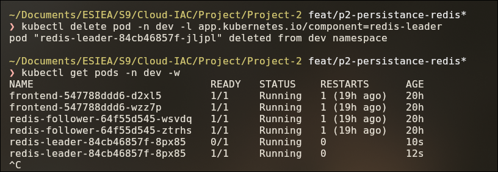

Le Deployment recrée un **nouveau** pod (nom différent), prêt en ~12 s. Il rebranche le **même**
PVC sur `/data`.

### 4. Recharger la page

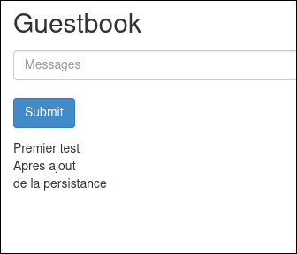

```bash
kubectl exec -n dev deploy/redis-leader -- redis-cli GET guestbook
```

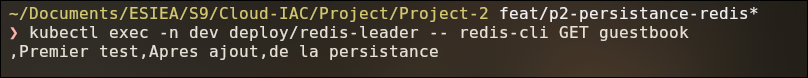

✅ **Les 3 messages sont toujours là.** Au démarrage, le nouveau Redis a relu le journal
`appendonly.aof` sur le disque.

### Avant / après

| | Partie 2 (sans persistance) | Partie 4 (avec persistance) |
|---|---|---|
| Messages écrits | 3 | 3 |
| Suppression du pod leader | ✔️ | ✔️ |
| Après redémarrage | ❌ [tous perdus](screenshots/10-messages-perdus.png) | ✅ [tous conservés](screenshots/21-messages-conserves-apres-suppression.png) |

---

## Étape 4.6 — Tests complémentaires

### Vérifier l'ordre de la stratégie `Recreate`

Une mise à jour du leader doit arrêter l'ancien pod **avant** de créer le nouveau.

```bash
# Terminal 1 (lancé en premier) : observer uniquement le leader
kubectl get pods -n dev -l app.kubernetes.io/component=redis-leader -w

# Terminal 2 : déclencher une mise à jour du leader
kubectl rollout restart deploy/redis-leader -n dev
```

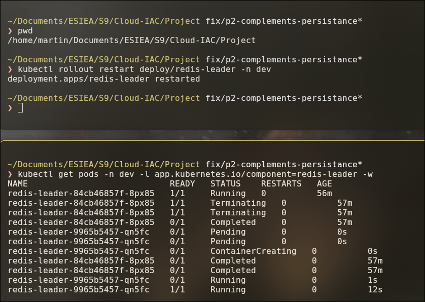

| Ordre | Ligne | Signification |
|---|---|---|
| ① | `84cb46857f-8px85` `Terminating` puis `Completed` | L'ancien Redis s'arrête |
| ② | `9965b5457-qn5fc` `Pending` puis `ContainerCreating` | Le nouveau pod n'apparaît **qu'ensuite** |
| ③ | `9965b5457-qn5fc` `1/1 Running` | Le nouveau Redis est prêt, après 12 s |

En `RollingUpdate`, le nouveau pod serait apparu **avant** l'arrêt de l'ancien. Les lignes
`Completed` de l'ancien pod plus bas correspondent à la suppression de l'objet : son conteneur
était déjà arrêté.

```bash
kubectl exec -n dev deploy/redis-leader -- redis-cli GET guestbook
```

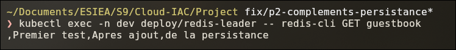

✅ Les messages sont conservés après la mise à jour.

### Redémarrage complet de minikube

Les messages doivent survivre à l'arrêt de **tout le cluster**.

```bash
minikube stop && minikube start
kubectl get pods -n dev -w               # Ctrl+C quand les 5 pods sont 1/1
```

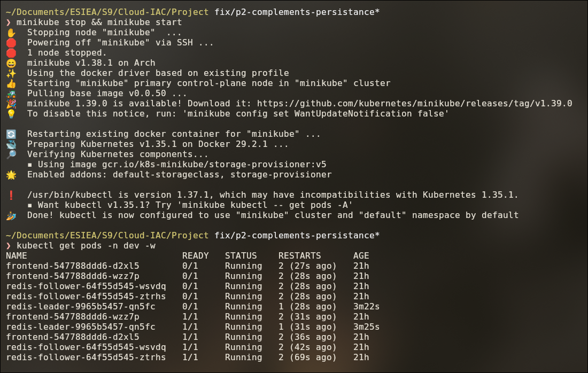

Chaque pod a redémarré (`RESTARTS` augmente de 1) et revient `1/1 Running`.

```bash
kubectl exec -n dev deploy/redis-leader -- redis-cli GET guestbook
```

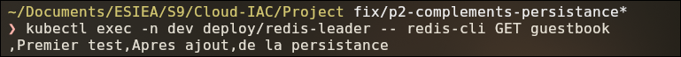

✅ Les messages sont conservés : le disque persistant survit à l'arrêt du cluster.

> Après un redémarrage, relancer `minikube tunnel` et relire l'`EXTERNAL-IP` avec
> `kubectl get svc frontend -n dev` : elle peut avoir changé.

---

## Vérifications utiles

```bash
kubectl get storageclass                                                  # classe par défaut
kubectl get pvc -n dev                                                    # Bound
kubectl get pv                                                            # le disque créé
kubectl get deploy redis-leader -n dev -o jsonpath='{.spec.strategy.type}'   # Recreate
kubectl exec -n dev deploy/redis-leader -- redis-cli CONFIG GET dir      # /data
kubectl exec -n dev deploy/redis-leader -- ls -l /data                   # appendonly.aof
```

> ⚠️ **Supprimer le PVC supprime le disque et les messages** (`RECLAIMPOLICY = Delete` sur la
> StorageClass `standard`). Ne jamais lancer `kubectl delete pvc` sans sauvegarde.

---

## ✅ Récapitulatif de la partie 4

- [x] ConfigMap `redis-leader-config` : `redis.conf` avec `dir /data` et `appendonly yes`.
- [x] PVC `redis-leader-data` : 1Gi, `ReadWriteOnce`, StorageClass par défaut.
- [x] Leader en stratégie `Recreate`, démarré avec `redis.conf`, disque monté sur `/data`.
- [x] Test de non-perte réussi dans `dev` : les messages survivent à la suppression du pod.
- [x] `Recreate` vérifié : l'ancien pod s'arrête avant la création du nouveau.
- [x] Bonus : messages conservés après un redémarrage complet de minikube.
- [ ] Bonus : même test après un `helm upgrade` (partie 6).

➡️ **Suite :** [Partie 5 — Le chart Helm](05-chart-helm.md).

---

[⬅️ Partie 3 — Les manifestes Kubernetes](03-manifestes-kubernetes.md) · [🏠 Sommaire](README.md) · [Partie 5 — Le chart Helm ➡️](05-chart-helm.md)
