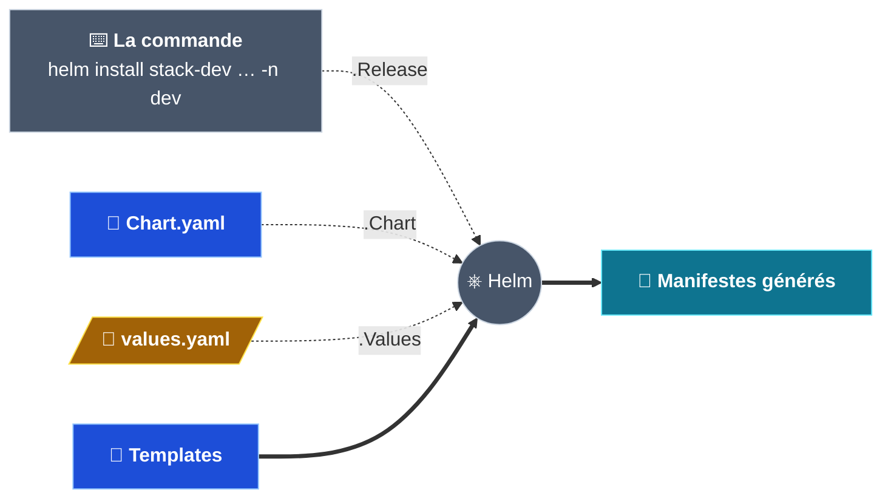
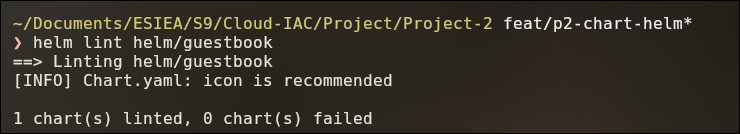

# Partie 5 — Le chart Helm

## Objectif

Transformer les manifestes de `k8s/` (parties 3 et 4) en **un seul chart Helm**, utilisable pour
les trois environnements.

| Sans Helm | Avec Helm |
|---|---|
| Copier et modifier les fichiers pour chaque environnement | **1 chart** + **1 fichier de valeurs** par environnement |
| `kubectl apply` fichier par fichier | `helm install / upgrade / rollback` d'un bloc |

> Cette partie construit et vérifie le chart. L'installation de `stack-dev`, `stack-staging` et
> `stack-prod` est l'objet de la partie 6.

---

## Étape 5.1 — Le principe

| Mot | Définition | Dans le projet |
|---|---|---|
| **Chart** | Le paquet Helm : des modèles de manifestes | `helm/guestbook/` |
| **Template** | Un manifeste contenant des expressions `{{ … }}` | `templates/frontend-service.yaml` |
| **Values** | Les valeurs utilisées par les templates | `values.yaml`, puis `values-<ENV>.yaml` |
| **Release** | Une installation du chart, avec un nom | `stack-dev` |

Helm remplace chaque expression `{{ … }}` par une information venant de **trois sources**, puis
génère les manifestes finaux :



### Lire un template

| Dans le template | Vient de | Exemple |
|---|---|---|
| `.Release.Name`, `.Release.Namespace` | **La commande** (pas un fichier) | `stack-dev`, `dev` |
| `.Chart.Name`, `.Chart.Version`, `.Chart.AppVersion` | **`Chart.yaml`** | `guestbook`, `0.1.0`, `v5` |
| `.Values.<clé>` | **`values.yaml`** / `values-<ENV>.yaml` | `.Values.frontend.service.port` = `80` |
| `include "guestbook.<nom>"` | Une **fonction de `_helpers.tpl`** qui combine les sources ci-dessus | `stack-dev-guestbook-frontend` |
| Texte sans `{{ }}` | Écrit tel quel | `targetPort: http` |

```bash
helm install   stack-dev    helm/guestbook   -n dev
#        .Release.Name = stack-dev    .Release.Namespace = dev
```

Le nom de la release n'est écrit dans aucun fichier : le **même** chart donne
`stack-dev-guestbook-frontend` avec `helm install stack-dev …` et `stack-prod-guestbook-frontend`
avec `helm install stack-prod …`.

> `helm template` prend les mêmes arguments que `helm install` mais **affiche** les manifestes au
> lieu de les installer. Les exemples de cette page ont été obtenus ainsi :
> `helm template stack-dev helm/guestbook -n dev`.

---

## Étape 5.2 — La structure du chart

```
helm/guestbook/
├── Chart.yaml        → identité du chart
├── .helmignore       → fichiers exclus du paquet (Git, éditeurs, fichiers temporaires)
├── values.yaml       → valeurs par défaut, toutes commentées
├── charts/           → dépendances (aucune)
└── templates/
    ├── _helpers.tpl  → noms et labels communs
    ├── NOTES.txt     → message affiché après l'installation
    └── 10 templates  → un par objet de k8s/, mêmes noms de fichiers
```

- Créé avec `helm create`, puis nettoyé des exemples inutiles (HTTPRoute, Ingress, ServiceAccount…).
- `namespaces.yaml` n'a **pas** de template : le namespace est donné à l'installation
  (`-n <ENV> --create-namespace`).
- `NOTES.txt` affiche la commande d'accès selon le type du Service frontend : `minikube tunnel`
  (LoadBalancer) ou `kubectl port-forward` (ClusterIP).

### `Chart.yaml`

```yaml
apiVersion: v2
name: guestbook
type: application
version: 0.1.0      # version du CHART (SemVer), incrémentée à chaque modification du chart
appVersion: "v5"    # version de l'APPLICATION déployée (tag de l'image frontend)
```

---

## Étape 5.3 — `_helpers.tpl` : les noms et les labels

`_helpers.tpl` contient des **fonctions** définies une seule fois (`define`) et appelées par
tous les templates (`include`). Le `_` indique à Helm de ne pas en faire un objet Kubernetes.

| Fonction | Résultat (release `stack-dev`) | Utilisée pour |
|---|---|---|
| `guestbook.fullname` | `stack-dev-guestbook` | Préfixe de tous les noms |
| `guestbook.componentName` | `stack-dev-guestbook-frontend` | Nom des Deployments et ConfigMaps |
| `guestbook.<composant>.serviceName` | `stack-dev-guestbook-redis-leader` | Nom des Services (et adresses dans les ConfigMaps) |
| `guestbook.redisLeader.pvcName` | `stack-dev-guestbook-redis-leader-data` | Nom du PVC |
| `guestbook.componentLabels` | Les labels communs + `component` | `metadata.labels` de tous les objets |
| `guestbook.componentSelectorLabels` | `name` + `instance` + `component` | `selector` des Deployments et Services |

### Deux listes de labels

```yaml
labels:                                        # sur tous les objets
  helm.sh/chart: guestbook-0.1.0               # change à chaque version du chart
  app.kubernetes.io/name: guestbook
  app.kubernetes.io/instance: stack-dev
  app.kubernetes.io/version: "v5"              # change à chaque version de l'application
  app.kubernetes.io/managed-by: Helm
  app.kubernetes.io/part-of: livre-or-cloud
  app.kubernetes.io/component: frontend
selector:                                      # dans les sélecteurs : labels stables uniquement
  app.kubernetes.io/name: guestbook
  app.kubernetes.io/instance: stack-dev
  app.kubernetes.io/component: frontend
```

Le sélecteur d'un Deployment ne peut plus être modifié après sa création. Il ne contient donc ni
`version` ni `helm.sh/chart` : sinon, le `helm upgrade` d'une nouvelle version échouerait.

---

## Étape 5.4 — Les templates

Chaque template reprend son manifeste `k8s/`. Ce qui peut changer selon l'environnement vient des
valeurs ; le reste est écrit en dur.

| Vient des valeurs | Reste écrit en dur |
|---|---|
| Nombre de pods, images, probes, ressources (blocs recopiés avec `toYaml`) | Ports des conteneurs (80, 6379) : imposés par les images |
| Nom, type et port du Service frontend | `type: ClusterIP` des Services Redis : jamais exposés |
| Variables de `frontend.env` (boucle `range` dans la ConfigMap) | `strategy: Recreate` du leader : contrainte du disque (partie 4) |
| Taille, accessMode et StorageClass du PVC | `redis.conf` : identique dans tous les environnements |

### Les adresses Redis sont calculées

Le nom du Service leader est produit par **une seule fonction**, utilisée par le Service **et**
par les ConfigMaps qui donnent son adresse :

```yaml
# ConfigMap frontend générée pour stack-dev
data:
  GET_HOSTS_FROM: "env"
  REDIS_LEADER_SERVICE_HOST: "stack-dev-guestbook-redis-leader"       # = nom du Service leader
  REDIS_FOLLOWER_SERVICE_HOST: "stack-dev-guestbook-redis-follower"   # = nom du Service followers
```

Le nom et l'adresse ne peuvent pas être différents, et chaque release contacte ses propres
Services Redis.

### L'annotation `checksum/config`

Kubernetes ne redémarre pas un pod quand sa ConfigMap change. Chaque Deployment porte donc
l'empreinte (`sha256sum`) de sa ConfigMap :

- la ConfigMap change → l'empreinte change → les pods sont recréés avec la nouvelle configuration ;
- rien ne change → aucun pod recréé (`helm upgrade` reste idempotent).

---

## Étape 5.5 — La StorageClass : le champ `storageClassName`

Le disque du leader doit être créé par la **StorageClass par défaut** du cluster (`standard` sur
minikube, `standard-rwo` sur GKE).

| Dans le PVC | Ce que Kubernetes comprend | Résultat |
|---|---|---|
| Champ **absent** | StorageClass par défaut | ✅ Disque créé |
| `storageClassName: ""` | **Aucune** StorageClass | ❌ PVC `Pending` |
| `storageClassName: standard` | Exactement cette classe | Seulement si elle existe (pas sur GKE) |

Une valeur vide n'est donc **pas** équivalente à une ligne absente. Le template n'écrit le champ
que si une classe est fournie :

```yaml
  {{- if .Values.redisLeader.persistence.storageClass }}
  storageClassName: {{ .Values.redisLeader.persistence.storageClass | quote }}
  {{- end }}
```

Avec la valeur par défaut `storageClass: ""`, le PVC généré ne contient pas la ligne.

---

## Étape 5.6 — `values.yaml`

`values.yaml` contient les **valeurs par défaut**. Chaque clé y est commentée (rôle, unité,
valeurs possibles) : c'est le fichier de référence pour modifier un réglage.

| Bloc | Clés principales |
|---|---|
| Communs | `nameOverride`, `fullnameOverride`, `partOf`, `commonLabels` |
| `frontend` | `replicaCount`, `image`, `env`, `service` (nom, type, port), probes, `resources` |
| `redisLeader` | `replicaCount` (doit rester 1), `image`, `service`, probes, `resources`, `persistence` (taille, accessMode, storageClass) |
| `redisFollower` | `replicaCount`, `image`, `service`, probes, `resources` |

Les fichiers `values-<ENV>.yaml` (partie 6) ne contiendront que les différences : port, nombre de
pods, ressources, taille du disque, label `environment`.

---

## Étape 5.7 — Vérifier le chart

Depuis `Project-2/`, sans rien installer :

```bash
helm lint helm/guestbook
```



`0 chart(s) failed` : le chart est valide (`icon is recommended` n'est qu'une suggestion).

| Vérification | Commande | Attendu |
|---|---|---|
| Manifestes générés | `helm template stack-dev helm/guestbook -n dev` | 10 objets `stack-dev-guestbook-…` |
| Acceptés par le cluster | `… \| kubectl apply -n dev --dry-run=server -f -` | 10 × `created (server dry run)` |
| Aucune valeur d'environnement en dur | `grep -rn "dev\|staging\|prod" helm/guestbook/templates/` | Aucune ligne |
| Aucun label écrit à la main | `grep -rn "app.kubernetes.io" helm/guestbook/templates/*.yaml` | Aucune ligne |
| Paquet | `helm package helm/guestbook` | `guestbook-0.1.0.tgz` |

> ⚠️ Même les commentaires des templates ne doivent pas contenir « dev », « staging » ou
> « prod » : le `grep` les détecterait.

---

## ✅ Récapitulatif de la partie 5

- [x] Chart `helm/guestbook/` à la structure standard.
- [x] Noms et labels définis une seule fois dans `_helpers.tpl` ; sélecteurs stables.
- [x] 10 templates, un par objet de `k8s/` ; adresses Redis calculées.
- [x] `storageClassName` écrit seulement si une classe est fournie.
- [x] `values.yaml` entièrement commenté.
- [x] `helm lint`, `helm template`, `helm package` et contrôles `grep` réussis.
- [x] Fichiers `values-<ENV>.yaml` et installation des trois releases → partie 6.

➡️ **Suite :** [Partie 6 — Les environnements dev / staging / prod](06-environnements-dev-staging-prod.md).

---

[⬅️ Partie 4 — La persistance des données](04-persistance-des-donnees.md) · [🏠 Sommaire](README.md) · [Partie 6 — Les environnements ➡️](06-environnements-dev-staging-prod.md)
