# Partie 6 — Les environnements dev / staging / prod

## Objectif

Installer **trois fois le même chart** sur minikube, avec des réglages différents, puis maîtriser
la vie d'une release : **installer → modifier → mettre à jour → revenir en arrière →
désinstaller**, sans jamais perdre de message.

| Environnement | Release | Namespace | Fichier de valeurs |
|---|---|---|---|
| dev | `stack-dev` | `dev` | `values-dev.yaml` |
| staging | `stack-staging` | `staging` | `values-staging.yaml` |
| prod | `stack-prod` | `prod` | `values-prod.yaml` |

> Toutes les commandes de cette page se lancent **depuis `Project-2/`**.

---

## Étape 6.1 — Le principe : un chart, trois fichiers de valeurs

`values.yaml` contient les **réglages par défaut**. Chaque `values-<ENV>.yaml` ne contient **que
ce qui change** pour son environnement. Helm les fusionne au moment de l'installation.

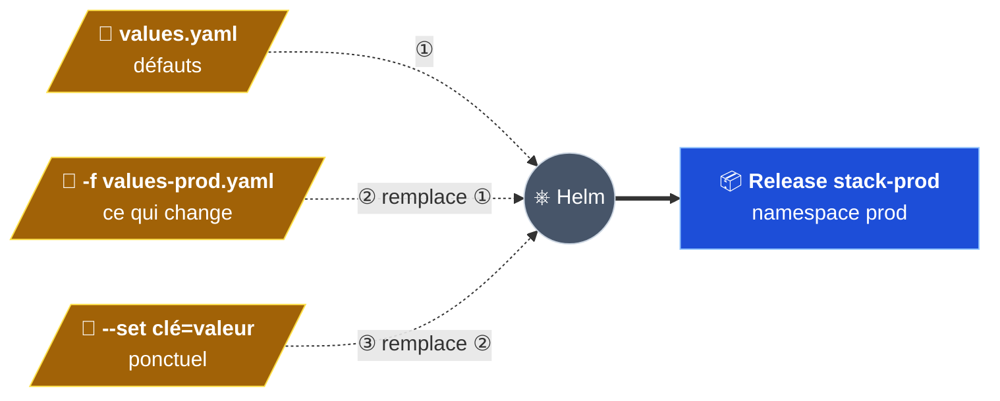

**Priorité : `--set` > `-f values-<ENV>.yaml` > `values.yaml`.** Une clé absente du fichier
de l'environnement garde sa valeur par défaut.

Helm ne devine pas le fichier à partir du nom : c'est l'option **`-f`** qui le désigne.

---

## Étape 6.2 — Les fichiers `values-<ENV>.yaml`

### Ce qui change entre les environnements

| Clé | Défaut | dev | staging | prod | Pourquoi |
|---|---|---|---|---|---|
| `commonLabels.environment` | `local` | `dev` | `staging` | `prod` | Label sur tous les objets |
| `frontend.service.port` | `80` | `8080` | `8081` | `80` | Exigé : un port par environnement |
| `frontend.replicaCount` | `1` | — | `2` | `3` | Tester une mise à jour sans coupure ; tolérer la perte d'un pod |
| `frontend.resources` | 100m / 128Mi → 250m / 256Mi | réduites | — | ×2 | Dev peu utilisé, prod dimensionnée |
| `redisLeader.resources` | idem | — | — | ×2 | Prod dimensionnée |
| `redisLeader.persistence.size` | `1Gi` | — | — | `5Gi` | Marge en prod |
| `redisLeader.persistence.keep` | `false` | — | — | `true` | Le disque de prod survit à `helm uninstall` (étape 6.11) |
| `redisFollower.replicaCount` | `1` | — | — | `2` | Lectures toujours servies si un follower redémarre |

« — » = pas de ligne dans le fichier : la valeur par défaut s'applique.

> **Pourquoi un port différent ?** Sous macOS / Windows, `minikube tunnel` publie tous les
> Services sur `127.0.0.1` : deux sites sur le port 80 seraient en conflit. Sous Linux, chaque
> Service a sa propre IP, mais on garde la même règle partout.

### Exemple : `values-staging.yaml`

```yaml
commonLabels:
  environment: staging
  team: plateforme
frontend:
  replicaCount: 2         # au moins 2 pour tester le RollingUpdate sans coupure
  service:
    port: 8081
```

### Vérifier les 3 fichiers

```bash
for env in dev staging prod; do
  helm lint helm/guestbook -f helm/guestbook/values-$env.yaml
done
```

`helm lint` vérifie le chart **avec les valeurs** de l'environnement, sans rien installer :
`1 chart(s) linted, 0 chart(s) failed` pour chacun (capture de l'étape 6.3).

---

## Étape 6.3 — Installer les trois environnements

### Avant toute commande Helm

```bash
kubectl config current-context     # doit afficher "minikube"
minikube status                    # host / kubelet / apiserver : Running
```

`current-context` dit **quel** cluster est visé, pas s'il est allumé. Si minikube est arrêté,
`helm install` échoue avec `cluster unreachable … no route to host` : lancer `minikube start`.

### Les namespaces

Les namespaces `dev`, `staging` et `prod` existent déjà : ils ont été créés en partie 3 par
`k8s/namespaces.yaml`, avec le label `environment`. On garde quand même `--create-namespace`
dans la commande : elle fonctionne aussi sur un cluster neuf (GKE). Helm ne pose pas de label
sur un namespace qu'il crée.

### Retirer l'ancienne application de `dev`

L'application installée « à la main » en parties 3 et 4 (`kubectl apply -f k8s/`) tournait encore
dans `dev`. Pour ne garder que la version Helm :

```bash
for f in k8s/*.yaml; do
  [ "$f" = "k8s/namespaces.yaml" ] || kubectl delete -n dev -f "$f"
done
```

`namespaces.yaml` est exclu : supprimer le namespace supprimerait tout ce qu'il contient.

### Installer

```bash
for env in dev staging prod; do
  helm lint helm/guestbook -f helm/guestbook/values-$env.yaml
  helm install stack-$env helm/guestbook/ --namespace $env --create-namespace \
    -f helm/guestbook/values-$env.yaml
done
```

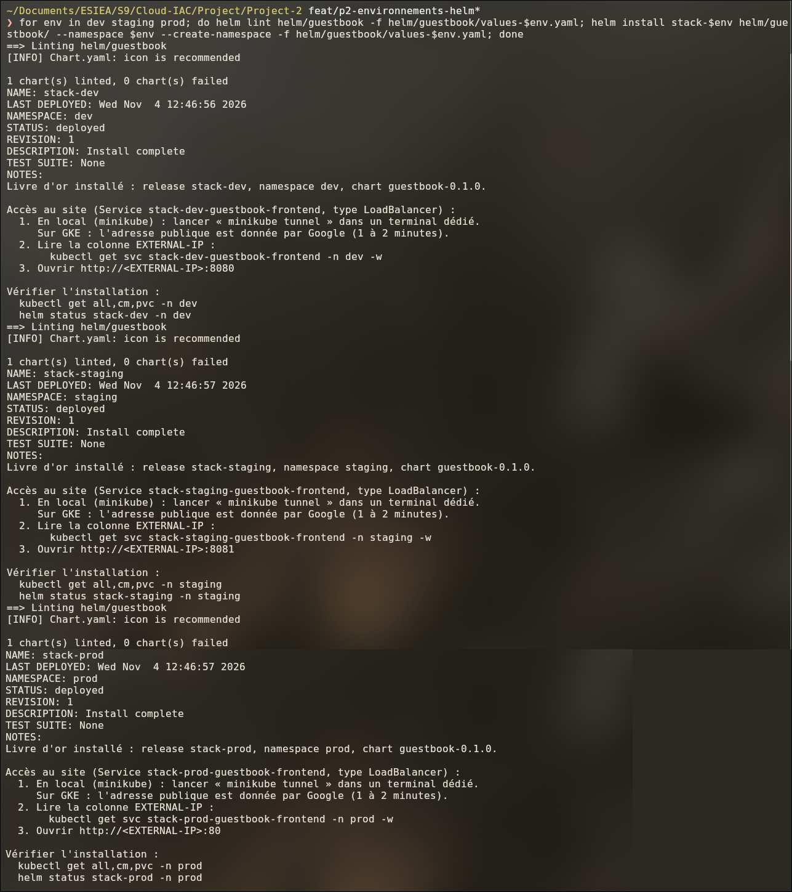

Pour chaque environnement : lint sans erreur, puis `STATUS: deployed`, `REVISION: 1`. Les NOTES
affichent le bon port : `:8080`, `:8081`, `:80`.

### Vérifier

```bash
helm list -A
```

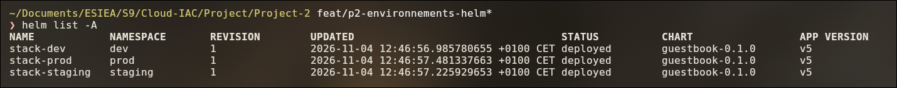

| Colonne | Valeur | Sens |
|---|---|---|
| `REVISION` | `1` | Première installation ; chaque `upgrade` ajoute 1 |
| `CHART` | `guestbook-0.1.0` | Version du **chart** (`version` de `Chart.yaml`) |
| `APP VERSION` | `v5` | Version de l'**application** (`appVersion`) |

```bash
kubectl get all,cm,pvc -n <ENV>
```

| dev | staging | prod |
|---|---|---|
| 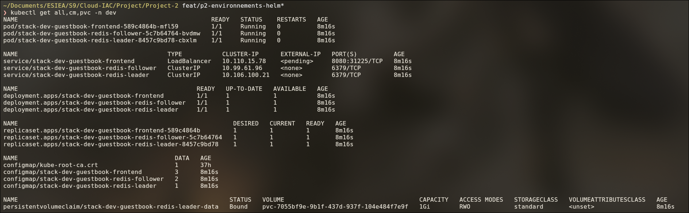 | 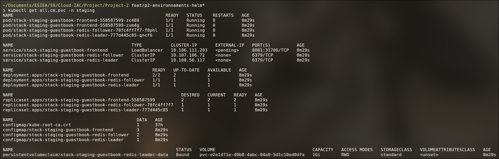 | 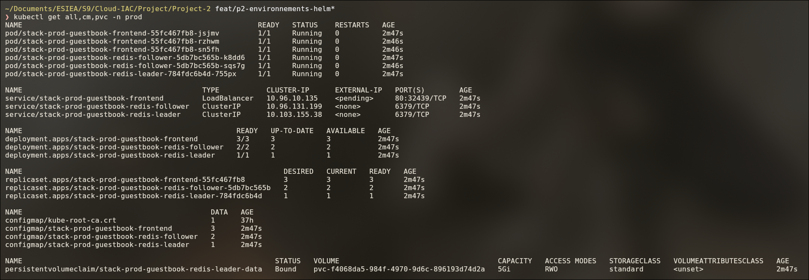 |

| | dev | staging | prod |
|---|---|---|---|
| Pods frontend | 1 | 2 | 3 |
| Pods follower | 1 | 1 | 2 |
| Port du site | 8080 | 8081 | 80 |
| Disque (PVC) | 1Gi | 1Gi | 5Gi |

Tous les noms commencent par `stack-<ENV>-guestbook-` : les objets des trois releases ne peuvent
pas entrer en conflit.

---

## Étape 6.4 — Ouvrir les trois sites

Dans un terminal dédié, laissé ouvert :

```bash
minikube tunnel        # demande le mot de passe sudo : il ajoute une route sur le poste
```

Puis :

```bash
kubectl get svc -A | grep frontend
```

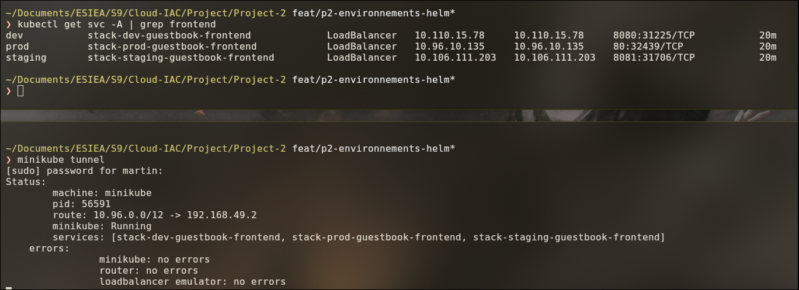

Adresse du site = **`EXTERNAL-IP`** + **premier** port de `PORT(S)` :

| Env | Adresse lors du test |
|---|---|
| dev | `http://10.110.15.78:8080` |
| staging | `http://10.106.111.203:8081` |
| prod | `http://10.96.10.135` |

> Les adresses changent à chaque création du Service : toujours relire la colonne `EXTERNAL-IP`.
> `<pending>` = le tunnel ne tourne pas.

**Isolation :** un message écrit en dev n'apparaît ni en staging ni en prod. Chaque release a
ses propres Services Redis : la ConfigMap du frontend de dev pointe vers
`stack-dev-guestbook-redis-leader`, et non vers celui de prod.

---

## Étape 6.5 — Persistance en prod

```bash
kubectl delete pod -n prod -l app.kubernetes.io/component=redis-leader
kubectl get pods -n prod -w        # le nouveau leader passe 0/1 → 1/1 en ~12 s
```

Après rechargement de la page de prod, le message est **toujours là** : le nouveau pod remonte le
même PVC et Redis relit son journal (partie 4).

---

## Étape 6.6 — Modifier un réglage d'un environnement

Exemple : passer staging à 3 frontends, **sans toucher aux templates**.

1. Dans `values-staging.yaml` : `frontend.replicaCount: 3`.

   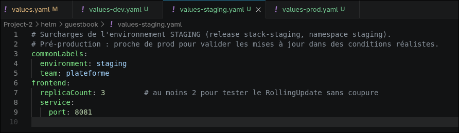

2. Appliquer :

   ```bash
   helm upgrade stack-staging helm/guestbook -n staging -f helm/guestbook/values-staging.yaml
   kubectl get deploy -n staging
   ```

   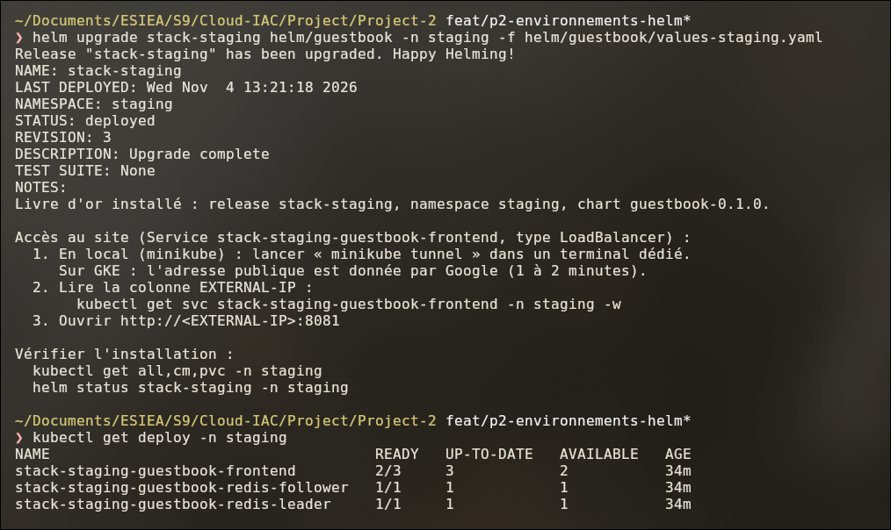

`REVISION: 3`, puis le frontend passe de `2/3` à `3/3` : un pod **ajouté**, les autres ne sont pas
recréés. Helm n'applique que la différence.

> ⚠️ Toujours repasser `-f values-<ENV>.yaml` dans un `upgrade`. Sans lui, la release repart des
> valeurs par défaut (port 80, 1 pod…).

Le fichier a ensuite été remis à `replicaCount: 2`.

---

## Étape 6.7 — Idempotence : relancer sans rien changer

Relancer `helm upgrade` avec **exactement** les mêmes valeurs ne doit rien casser ni recréer.

```bash
kubectl get pods -n prod           # noter les noms et les âges
helm upgrade stack-prod helm/guestbook/ -n prod -f helm/guestbook/values-prod.yaml
kubectl get pods -n prod           # mêmes noms, âges qui continuent
helm history stack-prod -n prod
```

| Avant | Après |
|---|---|
| 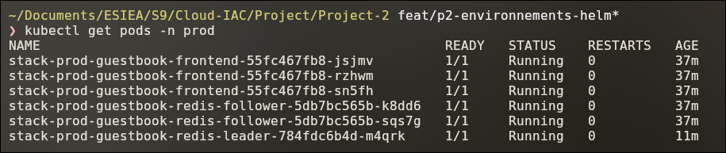 | 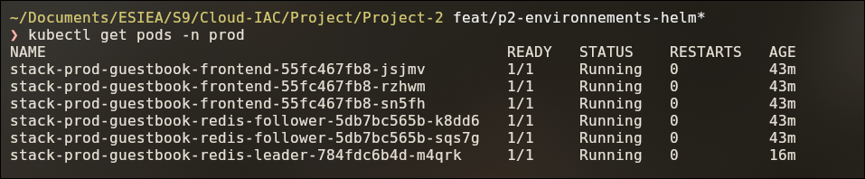 |

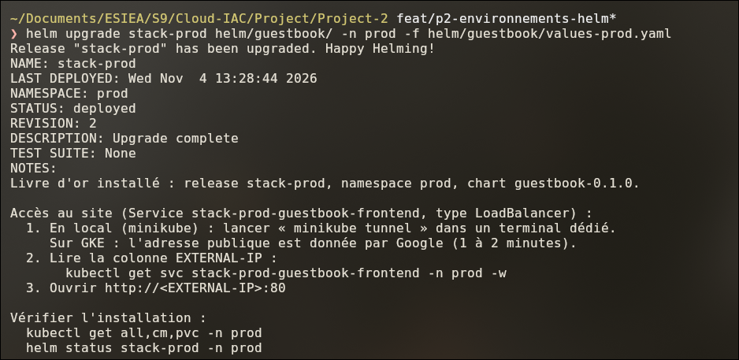

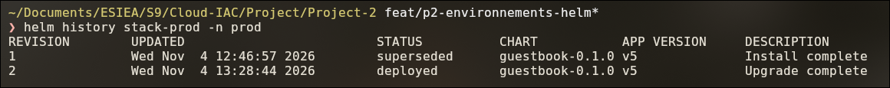

- Helm enregistre une **révision 2** : il garde la trace de chaque commande.
- Kubernetes ne voit **aucune différence** : aucun pod recréé, aucun redémarrage.

---

## Étape 6.8 — Monter la version du chart

1. Dans `Chart.yaml` : `version: 0.1.0` → **`0.2.0`**.
2. Appliquer et observer :

   ```bash
   helm upgrade stack-prod helm/guestbook/ -n prod -f helm/guestbook/values-prod.yaml
   kubectl get pods -n prod -w
   ```

   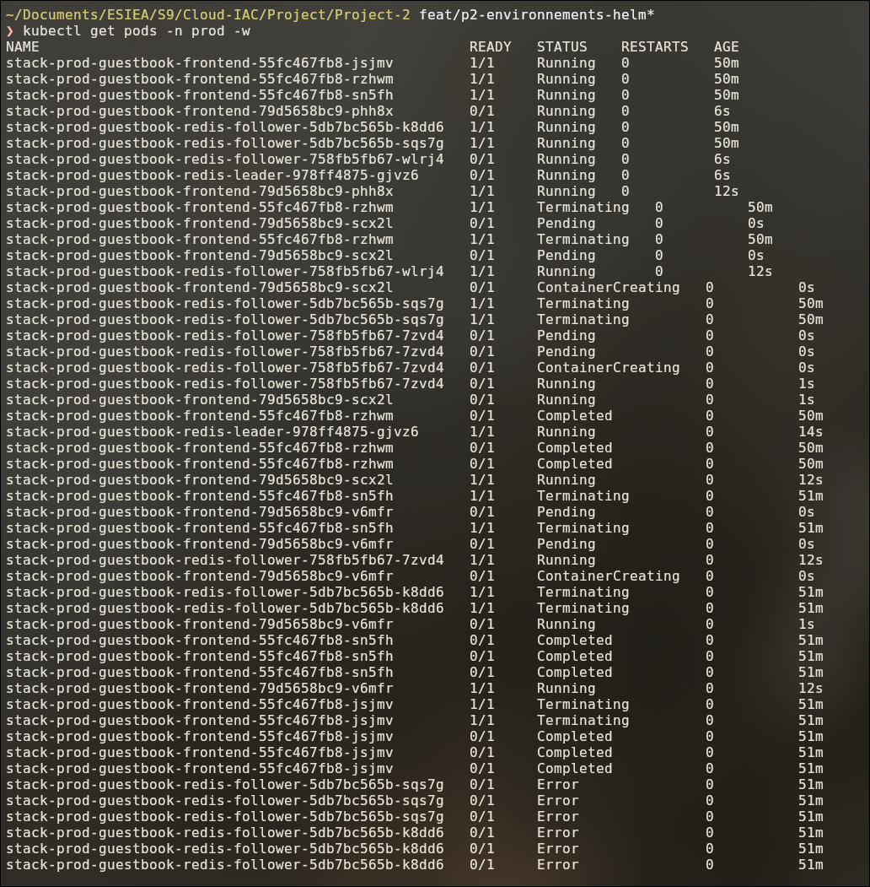

**Tous les pods sont remplacés** : le label `helm.sh/chart: guestbook-0.2.0` est dans le modèle
des pods, il a changé. Chaque composant est remplacé selon sa stratégie :

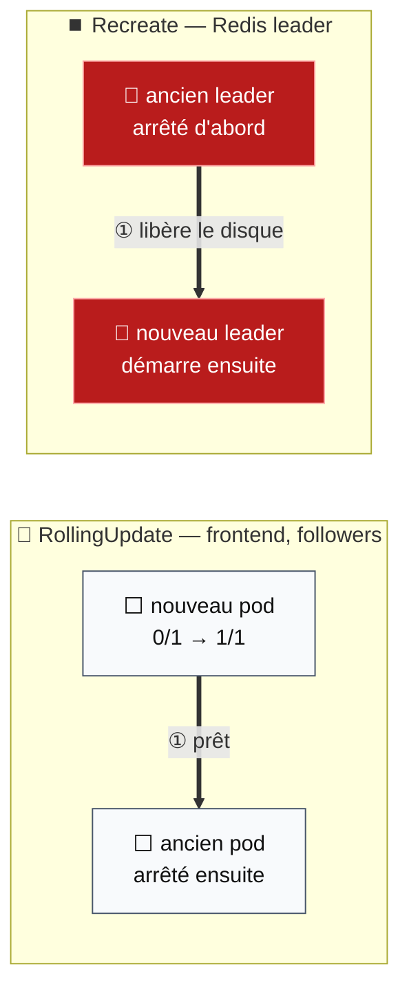

| Stratégie | Composants | Fonctionnement | Coupure |
|---|---|---|---|
| **RollingUpdate** (défaut) | frontend, followers | Un nouveau pod est créé ; quand il est **prêt** (readiness probe), un ancien est arrêté ; on recommence | Non |
| **Recreate** | Redis leader | L'ancien est arrêté, **puis** le nouveau démarre | Quelques secondes |

Le leader est en `Recreate` car son disque est `ReadWriteOnce` : un seul pod peut s'y brancher.

**États des anciens pods :**

| État | Pods | Explication |
|---|---|---|
| `Completed` | anciens frontends | Apache est le processus principal : il reçoit l'ordre d'arrêt (SIGTERM) et s'arrête proprement (code 0) |
| `Error` | anciens followers | Dans l'image Google, le processus principal est `/bin/sh -c /run.sh`, qui ignore SIGTERM et ne le transmet pas à Redis. Kubernetes force l'arrêt au bout de 30 s (code 137) |

Le `Error` des followers est **sans conséquence** : ils n'ont pas de données propres et leur
remplaçant était déjà prêt.

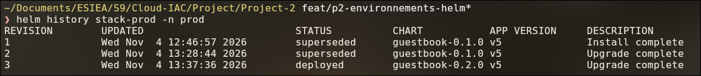

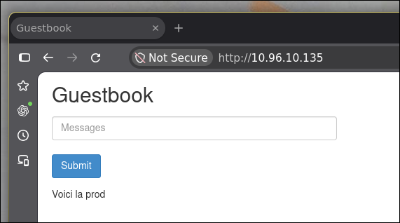

Nouvelle révision en `guestbook-0.2.0`, et le message de prod est **toujours là** : le PVC n'a
pas été recréé.

---

## Étape 6.9 — Revenir en arrière

```bash
helm history stack-prod -n prod
helm rollback stack-prod 1 -n prod
helm history stack-prod -n prod
```

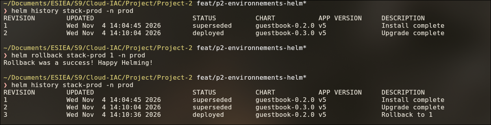

| Révision | Chart | Description |
|---|---|---|
| 1 | 0.2.0 | Install complete |
| 2 | 0.3.0 | Upgrade complete (montée de version) |
| 3 | **0.2.0** | **Rollback to 1** |

Un rollback **ne supprime aucune révision** : il en ajoute une, copie de la révision visée.

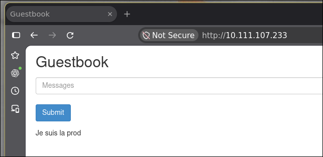

Le message est **toujours là** : le rollback remplace les pods, pas le disque.

> L'historique Helm est un **journal** : aucune commande ne permet d'en retirer une ligne. Un
> rollback lancé deux fois crée deux révisions identiques, sans effet sur le cluster
> ([capture 43](screenshots/43-helm-rollback-prod-history.png)). Ne jamais supprimer à la main
> les Secrets `sh.helm.release.v1.<release>.v<N>` qui stockent les révisions.

---

## Étape 6.10 — Local / cloud : passer le site en ClusterIP

Sur GKE, la première mise en ligne se fait **sans exposer le site** (partie 8). Le type du Service
frontend est une valeur ; on la change **ponctuellement** avec `--set`, sans fichier de plus :

```bash
helm upgrade stack-dev helm/guestbook -n dev -f helm/guestbook/values-dev.yaml \
  --set frontend.service.type=ClusterIP
kubectl port-forward svc/stack-dev-guestbook-frontend 9090:8080 -n dev
```

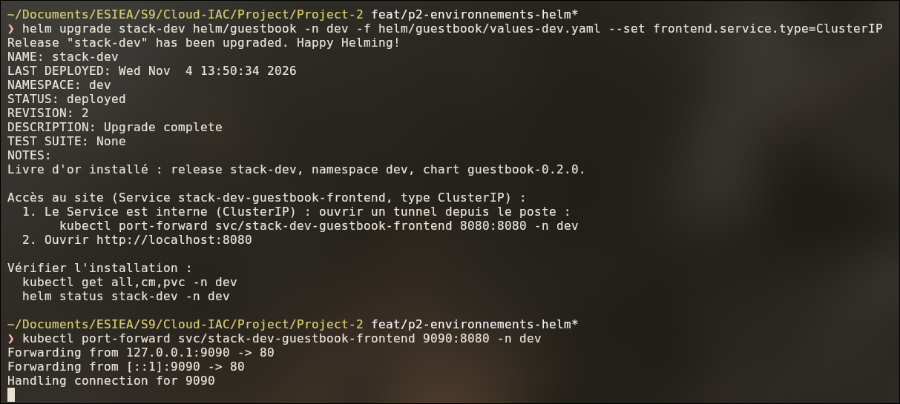

- Les NOTES s'adaptent seules : elles proposent `kubectl port-forward` au lieu de
  `minikube tunnel`.
- `9090:8080` = port **local** 9090 → port **du Service** 8080. Le port local est libre.

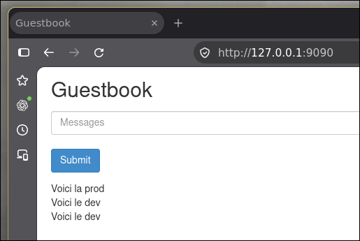

Le site répond sur `http://127.0.0.1:9090`, uniquement depuis le poste qui a lancé le tunnel.

**Retour en LoadBalancer :** relancer le même `helm upgrade` **sans** le `--set`.

> Choix : `--set` plutôt qu'un fichier `values-gke.yaml`, car **une seule** valeur diffère, et
> seulement pendant la phase de test.

---

## Étape 6.11 — Désinstaller : que devient le disque ?

```bash
helm uninstall stack-<ENV> -n <ENV>
kubectl get pvc -n <ENV>
```

| Environnement | `keep` | Après `helm uninstall` |
|---|---|---|
| dev, staging | `false` | PVC **supprimé**, puis le disque (StorageClass en `reclaimPolicy: Delete`) → **messages perdus** |
| prod | `true` | PVC **conservé** → messages conservés |

`keep: true` ajoute sur le PVC l'annotation **`helm.sh/resource-policy: keep`** (template
`redis-leader-pvc.yaml`). Helm ne supprime pas un objet qui porte cette annotation.

### Réutiliser le disque de prod

```bash
helm uninstall stack-prod -n prod
kubectl get pvc -n prod                # stack-prod-guestbook-redis-leader-data toujours là
helm install stack-prod helm/guestbook -n prod -f helm/guestbook/values-prod.yaml
```

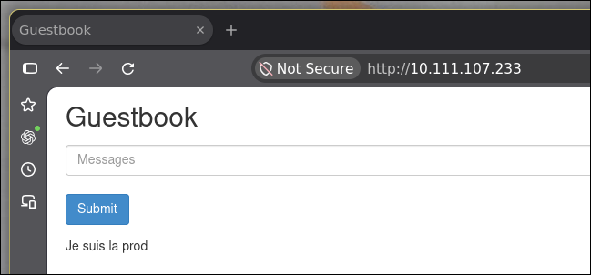

La nouvelle release crée un PVC **du même nom** : Kubernetes rebranche le disque existant, les
messages réapparaissent. Seule l'adresse du site change (le Service a été recréé).

> **Supprimer vraiment les données de prod :**
> `kubectl delete pvc stack-prod-guestbook-redis-leader-data -n prod` après le `helm uninstall`.

---

## ⚠️ Pièges rencontrés

| Symptôme | Cause | Solution |
|---|---|---|
| `cluster unreachable … no route to host` | minikube arrêté | `minikube start`, vérifier avec `minikube status` |
| `Error: repo helm not found` | Commande lancée hors de `Project-2/` : Helm lit `helm/guestbook` comme « chart `guestbook` du dépôt `helm` » | `cd Project-2` |
| `EXTERNAL-IP <pending>` | `minikube tunnel` non lancé | Le lancer dans un terminal dédié |
| La release repart sur les défauts | `-f values-<ENV>.yaml` oublié dans `helm upgrade` | Toujours repasser le fichier |
| PVC de prod supprimé malgré `keep: true` | La valeur existait mais aucun template ne la lisait | Annotation ajoutée dans `redis-leader-pvc.yaml` |

---

## ✅ Récapitulatif de la partie 6

- [x] `values-dev.yaml`, `values-staging.yaml`, `values-prod.yaml` : seulement les différences.
- [x] `helm lint` sans erreur pour les 3 environnements.
- [x] 3 releases `deployed`, chacune dans son namespace, sites séparés (ports 8080 / 8081 / 80).
- [x] Persistance en prod : pod leader supprimé, message conservé.
- [x] Réglage modifié par `values-staging.yaml` + `helm upgrade`, sans toucher aux templates.
- [x] Idempotence : `helm upgrade` sans changement → aucun pod recréé.
- [x] Montée de version du chart et rollback, message conservé à chaque étape.
- [x] Passage en ClusterIP par `--set` et accès par `kubectl port-forward`.
- [x] `helm uninstall` : PVC supprimé en dev, **conservé et réutilisé** en prod (`keep`).

➡️ **Suite :** [Partie 7 — Le cluster GKE avec Terraform](07-cluster-gke-terraform.md).

---

[⬅️ Partie 5 — Le chart Helm](05-chart-helm.md) · [🏠 Sommaire](README.md) · [Partie 7 — Le cluster GKE ➡️](07-cluster-gke-terraform.md)
