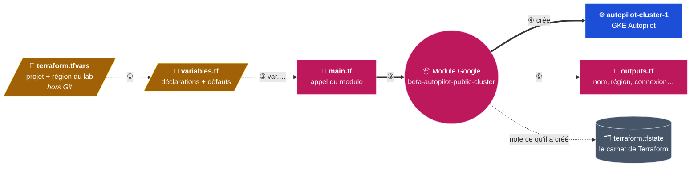
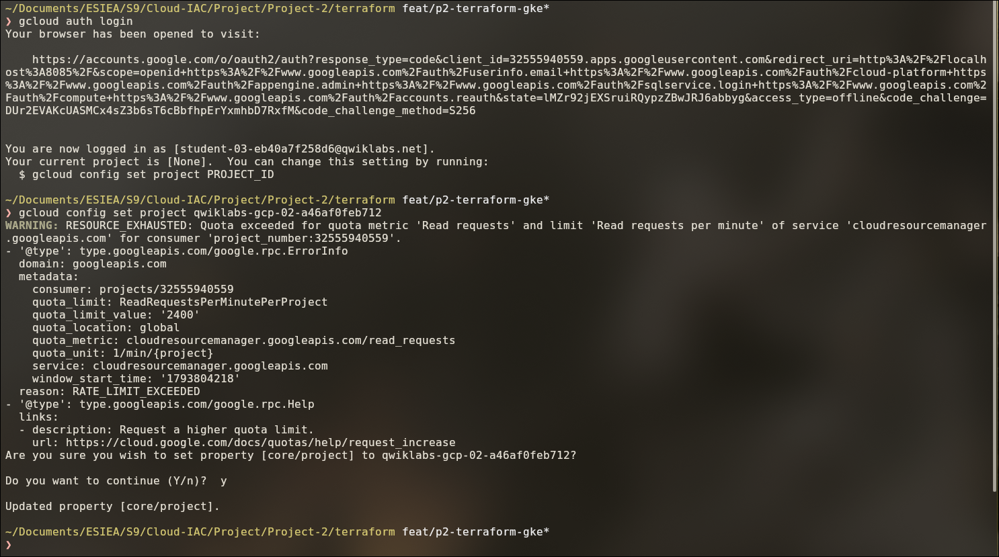
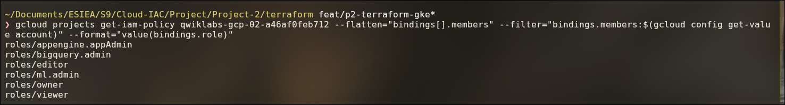
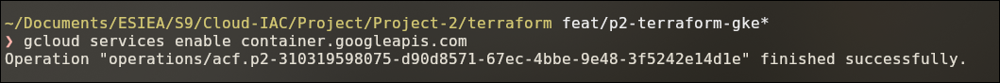
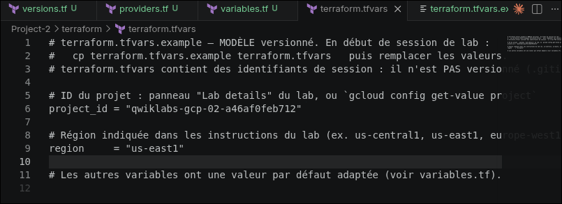
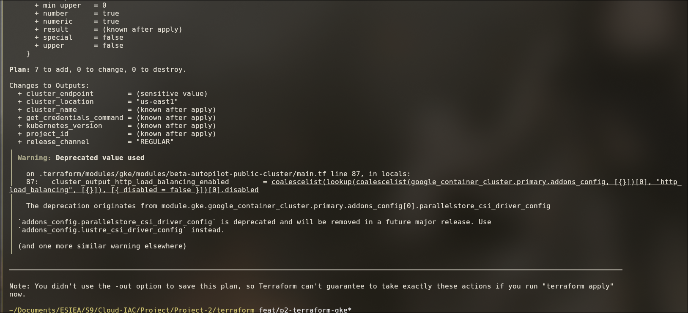
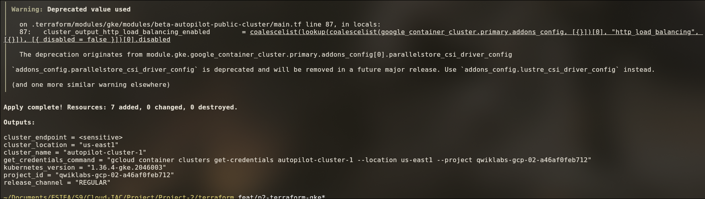
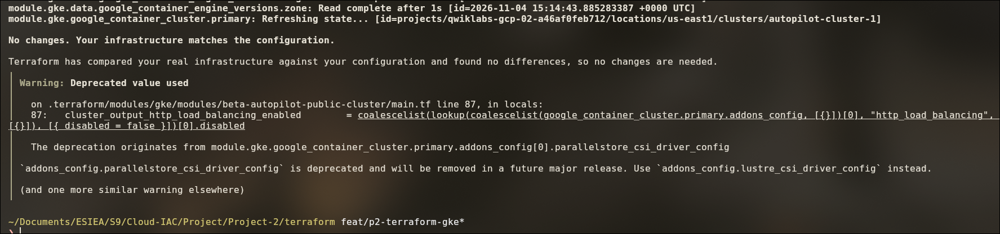
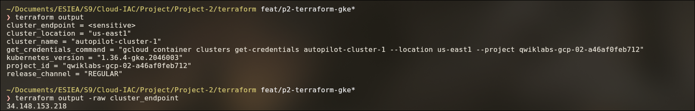
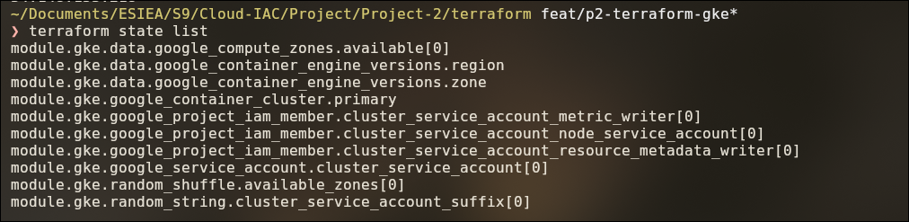

# Partie 7 — Le cluster GKE avec Terraform

## Objectif

Créer le cluster Kubernetes de Google (**GKE Autopilot**) **avec du code**, pour pouvoir le
recréer à l'identique à chaque session de lab, en quelques commandes.

| Outil | Crée | Ne crée pas |
|---|---|---|
| **Terraform** | Le cluster GKE (et son compte de service) | Rien **dans** le cluster |
| **Helm** | L'application dans le cluster (partie 8) | Aucune ressource Google Cloud |

> Toutes les commandes Terraform de cette page se lancent **depuis `Project-2/terraform/`**.

---

## Étape 7.1 — Le principe



- Le **module** officiel de Google contient le code qui crée le cluster ; `main.tf` lui donne
  les valeurs.
- Le **state** (`terraform.tfstate`) liste ce que Terraform a créé ; il sert à `plan` et à
  `destroy`.

---

## Étape 7.2 — Les fichiers

```
terraform/
├── versions.tf               → version de Terraform + providers (épinglés)
├── providers.tf              → projet et région utilisés par les providers
├── variables.tf              → toutes les variables (type, description, défaut)
├── main.tf                   → appel du module GKE
├── outputs.tf                → informations affichées après apply
├── terraform.tfvars.example  → modèle versionné
├── .terraform.lock.hcl       → versions EXACTES des providers (versionné)
└── terraform.tfvars          → valeurs réelles du lab (NON versionné)
```

### `main.tf` — le module imposé

| Argument | Valeur | Pourquoi |
|---|---|---|
| `source` | `terraform-google-modules/kubernetes-engine/google//modules/beta-autopilot-public-cluster` | Sous-module Autopilot à cluster public |
| `version` | `~> 46.0` | Toute version 46.x, jamais 47 (changement cassant) |
| `project_id` | `var.project_id` | Change à chaque session |
| `name` | `var.cluster_name` | `autopilot-cluster-1` |
| `region` | `var.region` | Autopilot est toujours **régional** |
| `network` / `subnetwork` | `var.network` / `var.subnetwork` | Réseau `default` fourni par le lab |
| `ip_range_pods` / `ip_range_services` | `var.ip_range_pods` / `var.ip_range_services` | `null` : GKE gère les adresses |
| `release_channel` | `var.release_channel` | `REGULAR` |
| `deletion_protection` | `var.deletion_protection` | `false`, sinon `terraform destroy` échoue |

`source` et `version` sont les **seules valeurs écrites en dur** : Terraform interdit de les
mettre en variables. Tous les autres arguments passent par une variable.

### `variables.tf` — les entrées

| Variable | Type | Défaut | Obligatoire | Description |
|---|---|---|---|---|
| `project_id` | `string` | — | ✅ | ID du projet du lab (validation : 6 à 30 caractères) |
| `region` | `string` | — | ✅ | Région du lab, ex. `us-east1` (validation : une **région**, pas une zone) |
| `cluster_name` | `string` | `autopilot-cluster-1` | | Nom imposé |
| `network` | `string` | `default` | | Réseau VPC |
| `subnetwork` | `string` | `default` | | Sous-réseau de la région |
| `ip_range_pods` | `string` | `null` | | Plage IP des pods (gérée par GKE) |
| `ip_range_services` | `string` | `null` | | Plage IP des Services (gérée par GKE) |
| `release_channel` | `string` | `REGULAR` | | Canal de mise à jour (validation : `RAPID`, `REGULAR` ou `STABLE`) |
| `deletion_protection` | `bool` | `false` | | Protection contre la suppression |

### `versions.tf` et `providers.tf` — les providers

| Provider | Source | Contrainte | Version installée | Rôle |
|---|---|---|---|---|
| `google` | `hashicorp/google` | `~> 8.0` | 8.10.0 | API Google Cloud |
| `google-beta` | `hashicorp/google-beta` | `~> 8.0` | 8.10.0 | Fonctions GKE en bêta (module `beta-…`) |
| `kubernetes` | `hashicorp/kubernetes` | `~> 3.0` | 3.4.0 | Exigé par le module (ne crée rien ici) |
| `random` | `hashicorp/random` | `~> 3.0` | 3.9.1 | Exigé par le module (tirages aléatoires) |

- Terraform ≥ **1.5.0** (`required_version`).
- Les contraintes sont **compatibles avec celles du module v46** (`google >= 7.28, < 9`).
- `providers.tf` donne le projet et la région. **Aucun identifiant dans le code** : la connexion
  vient de `gcloud` (étape 7.4).
- **`.terraform.lock.hcl` est versionné** : il fige les versions exactes (8.10.0…) et leurs
  empreintes, pour que toute l'équipe et le repreneur utilisent les **mêmes** providers.

### `outputs.tf` — les sorties

| Output | Lu dans le module | Exemple |
|---|---|---|
| `cluster_name` | `module.gke.name` | `autopilot-cluster-1` |
| `cluster_location` | `module.gke.location` | `us-east1` |
| `project_id` | découpé dans `module.gke.cluster_id` | `qwiklabs-gcp-…` |
| `cluster_endpoint` | `module.gke.endpoint` (**sensible**) | `<sensitive>` |
| `kubernetes_version` | `module.gke.master_version` | `1.36.4-gke.2046003` |
| `release_channel` | `module.gke.release_channel` | `REGULAR` |
| `get_credentials_command` | assemblé | `gcloud container clusters get-credentials autopilot-cluster-1 --location us-east1 --project <PROJECT_ID>` |

Les valeurs sont lues dans le **module**, pas recopiées des variables.

### `terraform.tfvars.example` — le modèle

`terraform.tfvars` contient l'ID du projet : il n'est **pas versionné** (`.gitignore` :
`*.tfvars`). Le modèle `.example`, lui, est versionné et indique où trouver chaque valeur.

---

## Étape 7.3 — Le lab Google Skills

| | |
|---|---|
| Lab | **Deploying GKE Autopilot Clusters from Cloud Shell** — https://www.skills.google/paths/11/course_templates/2/labs/686877 |
| Durée | **1 heure** : le projet et tout ce qu'il contient sont ensuite supprimés |
| Valeurs à relever | Compte, **Project ID** (panneau du lab), **région** (instructions du lab, ex. `us-east1`) |

- La durée est courte : lancer `terraform apply` **dès le début** de la session.
- ⚠️ Ne pas exécuter les « Tasks » du lab : elles créent `autopilot-cluster-1` à la main, et ce
  nom bloquerait Terraform.

---

## Étape 7.4 — Se connecter au projet du lab

### 1. Accepter les conditions d'utilisation

Ouvrir https://console.cloud.google.com avec le compte du lab et cliquer sur **Agree and
continue**. Sans cela, aucune API ne peut être activée (erreur `UREQ_TOS_NOT_ACCEPTED`).

### 2. Connecter `gcloud` et Terraform

Avec le compte du lab : `gcloud auth login` sert à `gcloud` et `kubectl`,
`gcloud auth application-default login` sert à **Terraform**.

```bash
gcloud auth login
gcloud config set project <PROJECT_ID>
gcloud auth application-default login
gcloud auth application-default set-quota-project <PROJECT_ID>
```



### 3. Vérifier le rôle du compte

```bash
gcloud projects get-iam-policy <PROJECT_ID> \
  --flatten="bindings[].members" \
  --filter="bindings.members:$(gcloud config get-value account)" \
  --format="value(bindings.role)"
```



**`roles/owner` doit apparaître.** Le module crée un compte de service et lui donne des droits
IAM sur le projet : un simple `roles/editor` ne peut pas modifier les droits IAM.

### 4. Activer l'API GKE

```bash
gcloud services enable container.googleapis.com
```



---

## Étape 7.5 — Créer le cluster

### Préparer

```bash
cp terraform.tfvars.example terraform.tfvars   # puis saisir project_id et region
terraform init                                 # télécharge le module 46.x et les providers
terraform fmt -check -recursive
terraform validate                             # → Success! The configuration is valid.
```



### Voir ce qui va être créé

```bash
terraform plan
```



`Plan: 7 to add, 0 to change, 0 to destroy.`

### Créer

```bash
terraform apply        # taper "yes"
```



`Apply complete! Resources: 7 added, 0 changed, 0 destroyed.` en quelques minutes, puis les
outputs.

### Idempotence

```bash
terraform plan
```



**`No changes. Your infrastructure matches the configuration.`** : pas de dérive persistante.

### Relire les sorties

```bash
terraform output
terraform output -raw cluster_endpoint     # valeur sensible, lue volontairement
```



L'endpoint (adresse de l'API Kubernetes) est masqué ; `-raw` l'affiche.

### Ce que Terraform a réellement créé

```bash
terraform state list
```



| Lignes | Type | Rôle |
|---|---|---|
| `data.google_compute_zones.available`, `data.google_container_engine_versions.region` / `.zone` | Lectures (3) | Infos demandées à Google, rien n'est créé |
| `google_container_cluster.primary` | Ressource | **Le cluster** `autopilot-cluster-1` |
| `google_service_account.cluster_service_account` | Ressource | Compte de service des nœuds |
| `google_project_iam_member.cluster_service_account_*` (×3) | Ressources | Ses droits : métriques, métadonnées, rôle de nœud |
| `random_shuffle.available_zones`, `random_string.cluster_service_account_suffix` | Ressources | Tirages internes au module |

Les 7 ressources créées (plus 3 lectures) viennent toutes du module.

> La connexion de `kubectl` au cluster (`get-credentials`) et le déploiement de l'application
> sont décrits en partie 8.

---

## Étape 7.6 — Le state et le lock file

| Fichier | Contenu | Dans Git ? | Pourquoi |
|---|---|---|---|
| `.terraform.lock.hcl` | Versions exactes et empreintes des providers | ✅ oui | Mêmes providers pour tous |
| `terraform.tfstate` | Description des ressources réelles, valeurs sensibles (endpoint…) | ❌ non | Propre à une session, peut contenir des secrets |
| `terraform.tfvars` | ID du projet du lab | ❌ non | Identifiant de session |

### Choix : un state local

| | |
|---|---|
| **Pourquoi** | Le projet du lab est détruit à chaque session : un state partagé n'aurait aucune durée de vie. |
| **Risques** | Perte du fichier → Terraform ne sait plus ce qu'il a créé. Pas de verrou → deux `apply` simultanés possibles. |
| **En entreprise** | Backend distant **GCS** (bucket versionné), avec verrouillage natif : |

```hcl
terraform {
  backend "gcs" {
    bucket = "<bucket-du-state>"
    prefix = "livre-or/gke"
  }
}
```

---

## Étape 7.7 — En fin de session

L'application est d'abord désinstallée avec Helm (partie 8), puis :

```bash
terraform destroy      # taper "yes" ; plusieurs minutes
```

---

## ⚠️ Pièges rencontrés

| Symptôme | Cause | Solution |
|---|---|---|
| `UREQ_TOS_NOT_ACCEPTED` à `gcloud services enable` | Conditions d'utilisation jamais acceptées par le compte du lab | Ouvrir la console avec ce compte, **Agree and continue** |
| `WARNING: RESOURCE_EXHAUSTED` à `gcloud config set project` | Quota du projet Google partagé de `gcloud` | Sans gravité, répondre `y` |
| `terraform fmt -check` signale `terraform.tfvars` | Espaces d'alignement en trop | `terraform fmt terraform.tfvars` |
| `Warning: Deprecated value used` au `plan` / `apply` | Code du module Google (version 46 imposée) | Sans effet, à ignorer |

---

## ✅ Récapitulatif de la partie 7

- [x] Cluster créé **uniquement** par le module `beta-autopilot-public-cluster` v46, avec les
      arguments imposés.
- [x] Tous les arguments en variables, déclarées dans `variables.tf` seulement ; pas de défaut
      pour `project_id` ni `region` ; validations.
- [x] `terraform.tfvars.example` versionné, `terraform.tfvars` ignoré.
- [x] Providers épinglés dans `versions.tf`, lock file versionné.
- [x] Outputs lus dans le module, endpoint sensible, commande de connexion prête.
- [x] `fmt -check`, `validate`, `plan`, `apply` OK ; `plan` après `apply` → `No changes`.
- [x] Ressources réellement créées listées (`state list`).
- [x] Choix du state local documenté (risques, backend GCS en entreprise).

➡️ **Suite :** Partie 8 — Le déploiement dans le cloud *(à venir)*.

---

[⬅️ Partie 6 — Les environnements dev / staging / prod](06-environnements-dev-staging-prod.md) · [🏠 Sommaire](README.md)
