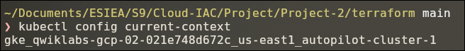
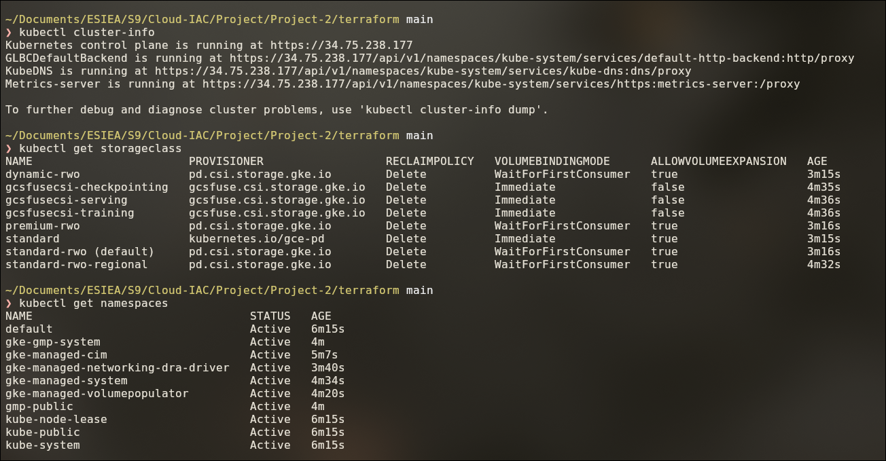
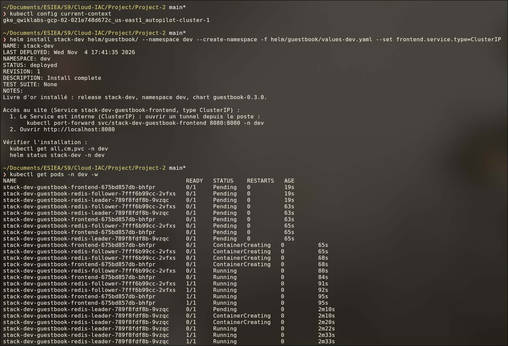
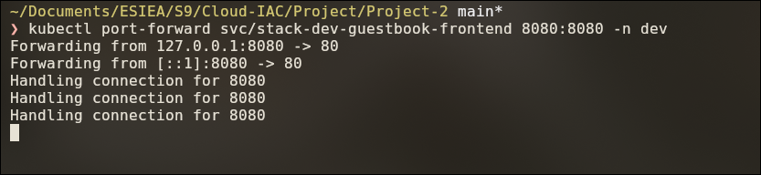
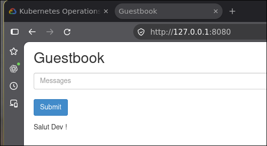
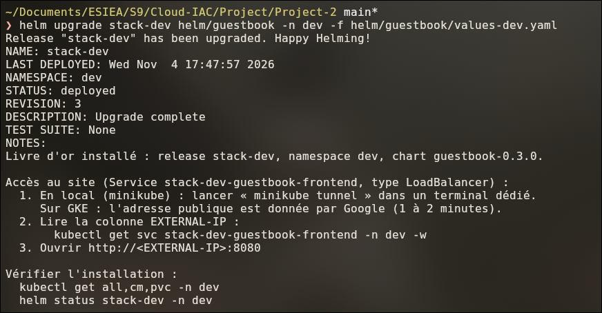
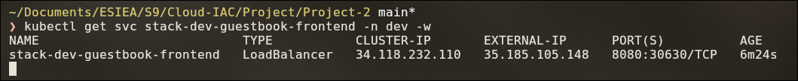
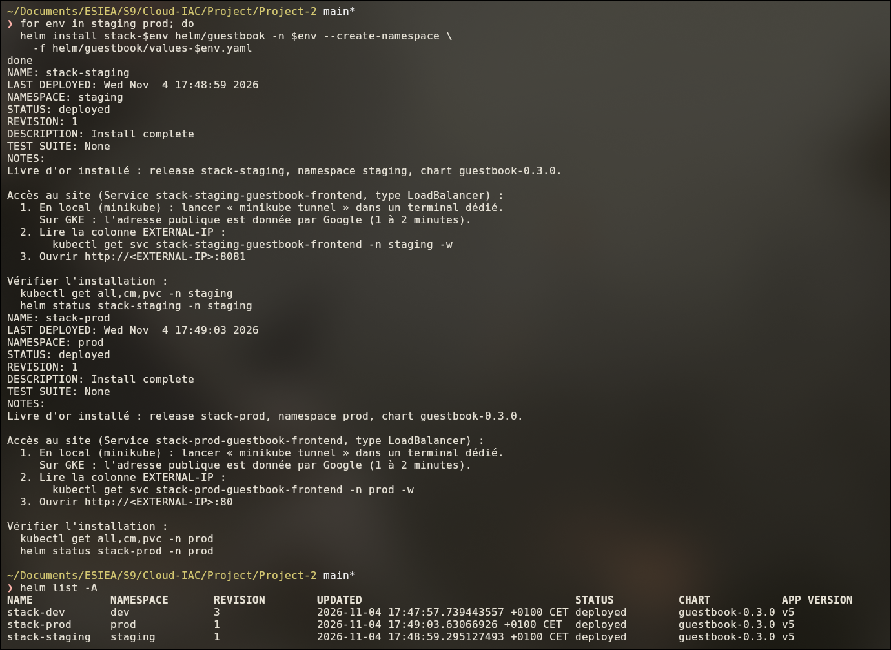
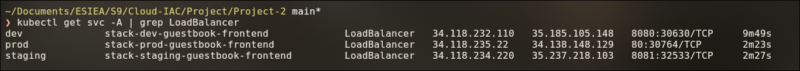
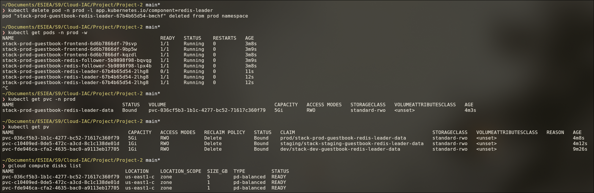

# Partie 8 — Le déploiement dans le cloud (GKE)

## Objectif

Installer l'application sur le cluster GKE de la partie 7. Le chart Helm et les fichiers de
valeurs sont **les mêmes** qu'en local. La séquence est imposée :

1. **Test** : Service `ClusterIP` + `kubectl port-forward`. Rien n'est exposé sur Internet.
2. **Ouverture** : `helm upgrade` → Service `LoadBalancer` → IP publique.

> Prérequis : cluster créé (partie 7). Les commandes Helm se lancent **depuis `Project-2/`**.

| | Local (minikube) | Cloud (GKE) |
|---|---|---|
| Chart et `values-<ENV>.yaml` | identiques | identiques |
| Accès au site | `LoadBalancer` + `minikube tunnel` | `ClusterIP` + `port-forward`, puis `LoadBalancer` (IP publique Google) |
| StorageClass par défaut | `standard` | `standard-rwo` (disque persistant Google) |
| Contexte `kubectl` | `minikube` | `gke_<projet>_<région>_autopilot-cluster-1` |

---

## Étape 8.1 — Se connecter au cluster

```bash
gke-gcloud-auth-plugin --version                # plugin d'authentification présent
cd Project-2/terraform
eval "$(terraform output -raw get_credentials_command)"
# = gcloud container clusters get-credentials autopilot-cluster-1 --location <REGION> --project <PROJECT_ID>
```

`get-credentials` ajoute le cluster dans `~/.kube/config` et le sélectionne.

```bash
kubectl config current-context
```



```bash
kubectl cluster-info
kubectl get storageclass
kubectl get namespaces
```



- Le cluster répond.
- `standard-rwo (default)` : le PVC du chart n'indique pas de `storageClassName`. Il reçoit
  donc cette classe.
- Seuls les namespaces système existent : le cluster est vide.

### Passer du local au cloud

```bash
kubectl config get-contexts                          # l'étoile = contexte actif
kubectl config use-context minikube                  # travailler en local
kubectl config use-context gke_<PROJECT_ID>_<REGION>_autopilot-cluster-1   # travailler sur GKE
```

> 🛡️ **Avant chaque `helm install` / `helm upgrade` : `kubectl config current-context`.**

---

## Étape 8.2 — dev en ClusterIP : le test

```bash
cd Project-2
kubectl config current-context
helm install stack-dev helm/guestbook --namespace dev --create-namespace \
  -f helm/guestbook/values-dev.yaml --set frontend.service.type=ClusterIP
kubectl get pods -n dev -w
```



- Les NOTES proposent la commande `kubectl port-forward`.
- La première installation prend ≈ 2 min 30. Autopilot crée les nœuds à la demande
  (`Pending`). Il crée ensuite le disque du leader.

Dans un second terminal, laissé ouvert :

```bash
kubectl port-forward svc/stack-dev-guestbook-frontend 8080:8080 -n dev
```

| Tunnel | Site par le tunnel |
|---|---|
|  |  |

Le site répond sur `http://127.0.0.1:8080`, depuis ce poste seulement. On y saisit un message.

---

## Étape 8.3 — dev en LoadBalancer : l'ouverture

`Ctrl+C` sur le port-forward, puis le même `upgrade` **sans** le `--set` :

```bash
helm upgrade stack-dev helm/guestbook -n dev -f helm/guestbook/values-dev.yaml
kubectl get svc stack-dev-guestbook-frontend -n dev -w   # attendre l'EXTERNAL-IP (1-2 min)
```

| `helm upgrade` | Adresse publique |
|---|---|
|  |  |

- Sans `--set`, la valeur de `values.yaml` s'applique : `LoadBalancer`.
- Google crée un équilibreur de charge avec une **IP publique** (colonne `EXTERNAL-IP`).
- Site : `http://<EXTERNAL-IP>:8080`.

---

## Étape 8.4 — staging et prod

```bash
for env in staging prod; do
  helm install stack-$env helm/guestbook -n $env --create-namespace \
    -f helm/guestbook/values-$env.yaml
done
helm list -A
```



3 releases `deployed`, une par namespace, chart `guestbook-0.3.0`.

```bash
kubectl get svc -A | grep LoadBalancer
```



| Env | Site |
|---|---|
| dev | `http://<EXTERNAL-IP dev>:8080` |
| staging | `http://<EXTERNAL-IP staging>:8081` |
| prod | `http://<EXTERNAL-IP prod>` |

Sur GKE, chaque Service `LoadBalancer` a sa propre IP publique.

> Choix : staging et prod sont installés directement en `LoadBalancer`. Le test
> ClusterIP → port-forward est fait sur dev.

---

## Étape 8.5 — Persistance sur GKE

```bash
kubectl delete pod -n prod -l app.kubernetes.io/component=redis-leader
kubectl get pods -n prod -w          # nouveau leader 1/1
kubectl get pvc -n prod
kubectl get pv
gcloud compute disks list
```



- Le pod leader est recréé en ≈ 12 s.
- PVC `Bound`, 5Gi, `standard-rwo`.
- **Où sont les données :** pod → PVC → PV → **disque persistant Google** (`pd-balanced`,
  zonal). `gcloud compute disks list` le montre sous le nom du PV.

Vérification : recharger le site de prod. Les messages saisis avant la suppression sont là.

---

## Étape 8.6 — Montée de version et retour arrière

Mêmes commandes qu'en local ([partie 6](06-environnements-dev-staging-prod.md), étapes 6.8 et 6.9) :

```bash
# Chart.yaml : version + 1
helm upgrade stack-prod helm/guestbook -n prod -f helm/guestbook/values-prod.yaml
helm history stack-prod -n prod
helm rollback stack-prod <révision> -n prod      # si besoin
```

Le PVC n'est pas recréé : les messages restent.

---

## Étape 8.7 — En fin de session

```bash
kubectl config current-context                   # GKE, pas minikube !
helm uninstall stack-dev -n dev
helm uninstall stack-staging -n staging
helm uninstall stack-prod -n prod
kubectl delete pvc --all -n prod                 # PVC de prod conservé par l'annotation keep
cd terraform && terraform destroy
```

Les LoadBalancer et les disques des PVC sont créés par Kubernetes. Terraform ne les connaît
pas. Il faut les supprimer **avant** `terraform destroy`.

Nouvelle session de lab : le projet précédent n'existe plus. Supprimer `terraform.tfstate` et
`terraform.tfvars`, puis reprendre la partie 7 à l'étape 7.4.

---

## ⚠️ Pièges rencontrés

| Symptôme | Cause | Solution |
|---|---|---|
| Pods `Pending` ≈ 1 min à la 1ʳᵉ installation | Autopilot crée les nœuds à la demande | Attendre (`kubectl get pods -w`) |
| `EXTERNAL-IP <pending>` | L'équilibreur de charge Google est en création | Attendre 1-2 min (`-w`) |
| `terraform plan` en erreur au début d'une nouvelle session | `terraform.tfstate` de la session précédente | Le supprimer (projet détruit) |
| `invalid_grant: Bad Request` (`gcloud`) | Session de lab terminée ou relancée | Se reconnecter avec les nouveaux identifiants |
| `current-context is not set` | Aucun contexte dans `~/.kube/config` | `get-credentials` (GKE) ou `minikube update-context` (local) |

---

## ✅ Récapitulatif de la partie 8

- [x] Plugin présent, `get-credentials`, `cluster-info`, `get namespaces` sur GKE.
- [x] Bascule de contexte minikube ↔ GKE documentée.
- [x] dev : ClusterIP + port-forward, puis `helm upgrade` → LoadBalancer avec IP publique.
- [x] staging et prod installés ; `helm list -A` → 3 releases `deployed`.
- [x] PVC provisionnés par `standard-rwo` ; pod leader de prod recréé, disque Google conservé.
- [x] Même chart et mêmes fichiers de valeurs qu'en local.

➡️ **Suite :** [Partie 9 — Exploitation](09-exploitation.md).

---

[⬅️ Partie 7 — Le cluster GKE avec Terraform](07-cluster-gke-terraform.md) · [🏠 Sommaire](README.md) · [Partie 9 — Exploitation ➡️](09-exploitation.md)
