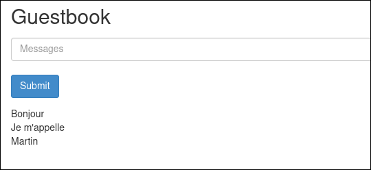
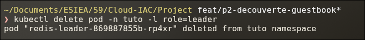
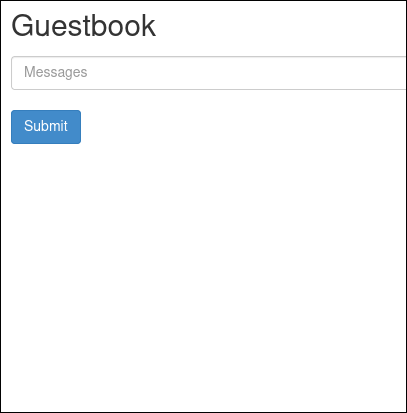
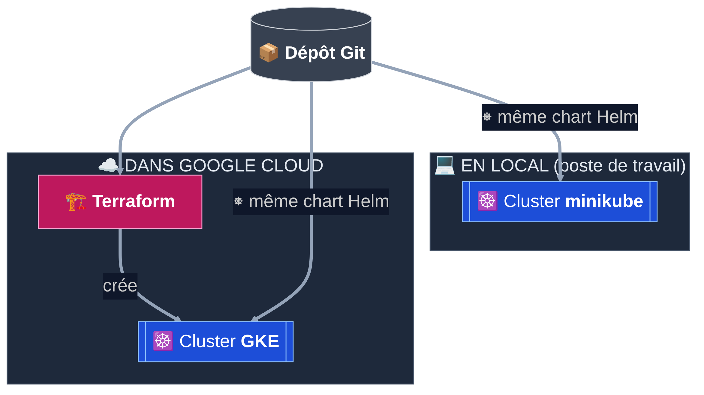
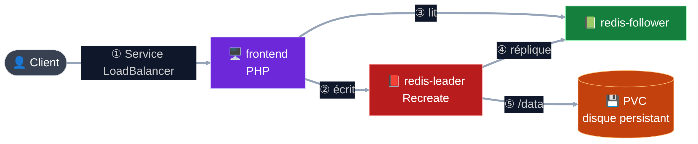
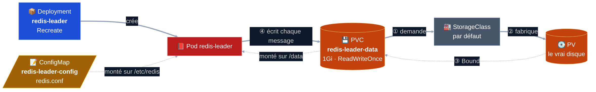
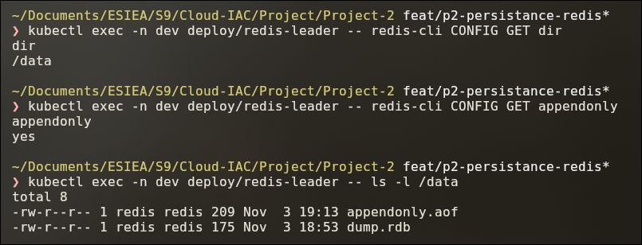
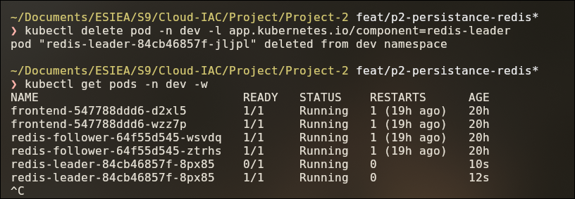
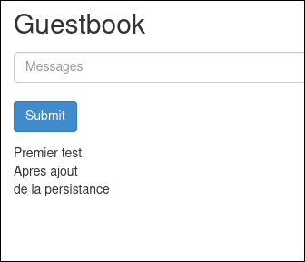

<!-- _class: lead -->
<!-- _paginate: false -->
<!-- _footer: "" -->

# Livre d'or Cloud

GKE · Terraform · Helm — passation à l'équipe d'exploitation

Équipe Plateforme · ESIEA S9

---

## Le contexte

- **Cloud Hôtels** : une quarantaine d'hôtels
- Un **livre d'or numérique** : le client écrit un message en fin de séjour
- Les messages s'affichent dans le hall de l'hôtel
- Un prototype existe : l'application **Guestbook** (site PHP + Redis)

---

## Ce qu'on nous a demandé

| # | Objectif | Comment |
|---|---|---|
| 1 | **Ne perdre aucun message** | Disque persistant |
| 2 | **Héberger dans le cloud** | Cluster GKE Autopilot |
| 3 | **Créer le cluster en code** | Terraform |
| 4 | **3 environnements isolés** | Un chart Helm : dev, staging, prod |
| 5 | **Travailler en local** | minikube, même chart |

---

## Au programme

1. Le problème
2. L'architecture
3. Kubernetes et persistance
4. Helm : un chart, 3 environnements
5. Terraform et le cloud
6. Exploitation, décisions, limites
7. Démonstration

---

<!-- _class: part -->
<!-- _paginate: false -->

# <em>01</em> Le problème

Un prototype qui perd ses messages

---

<!-- _class: split -->

## Le livre d'or fonctionne…

- Application d'origine du tutoriel Kubernetes
- Installée telle quelle sur minikube
- On écrit **3 messages**



---

## … jusqu'au redémarrage de Redis

On simule une panne : on supprime le pod de la base.

```bash
kubectl delete pod -n tuto -l role=leader
```



Kubernetes recrée aussitôt un nouveau pod.

---

<!-- _class: split -->

## Résultat : tout est perdu

- Le nouveau pod Redis démarre **vide**
- Les 3 messages ont **disparu**
- C'est le problème vécu par le client



---

## D'où ça vient : le Deployment `redis-leader`

```yaml
# k8s/tutoriel-origine/redis-leader-deployment.yaml (extrait)
    spec:
      containers:
      - name: leader
        image: "docker.io/redis:6.0.5"
        resources:
          requests:
            cpu: 100m
            memory: 100Mi
        ports:
        - containerPort: 6379
      # ❌ pas de volumeMounts : rien n'est monté sur /data
      # ❌ pas de volumes : aucun disque
      # ❌ pas de fichier de configuration Redis
```

Redis garde les messages **dans le conteneur**. Le pod disparaît → les données aussi.

---

## D'où ça vient : les fichiers fournis

```text
k8s/tutoriel-origine/
├── frontend-deployment.yaml
├── frontend-service.yaml
├── redis-follower-deployment.yaml
├── redis-follower-service.yaml
├── redis-leader-deployment.yaml
└── redis-leader-service.yaml
```

- ❌ Aucun **PersistentVolumeClaim** : pas de disque persistant
- ❌ Aucune **ConfigMap** : pas de `redis.conf`, donc pas de journal AOF
- Uniquement des Deployments et des Services

---

<!-- _class: part -->
<!-- _paginate: false -->

# <em>02</em> L'architecture

Terraform crée le cluster, Helm installe l'application

---

## Vue d'ensemble : local et cloud



- **Terraform** → ressources Google : le cluster
- **Helm** → objets Kubernetes : l'application, **le même chart** en local et sur GKE

---

## Ce que contient un environnement



- Le **leader** écrit chaque message sur un **disque persistant** (PVC)
- Installé **3 fois** : `stack-dev`, `stack-staging`, `stack-prod`, un namespace chacun

---

## Les objets d'une release

| Composant | Deployment | Service | ConfigMap | Disque |
|---|---|---|---|---|
| frontend | ✅ | `LoadBalancer` | adresses Redis | — |
| redis-leader | ✅ `Recreate` | `ClusterIP` 6379 | `redis.conf` | PVC |
| redis-follower | ✅ | `ClusterIP` 6379 | adresse du leader | — |

**10 objets**, tous nommés `stack-<ENV>-guestbook-…`

---

<!-- _class: part -->
<!-- _paginate: false -->

# <em>03</em> La persistance

Les messages survivent au redémarrage de Redis

---

## Le principe : un disque pour Redis



| Fichier | Rôle |
|---|---|
| `redis-leader-pvc.yaml` | **Nouveau** : demande un disque de 1Gi |
| `redis-leader-configmap.yaml` | **Nouveau** : dit à Redis d'écrire sur ce disque |
| `redis-leader-deployment.yaml` | **Modifié** : branche le disque et la configuration |

---

## ① Le PVC : demander un disque

```yaml
# k8s/redis-leader-pvc.yaml
apiVersion: v1
kind: PersistentVolumeClaim
metadata:
  name: redis-leader-data
spec:
  accessModes:
    - ReadWriteOnce        # un seul nœud à la fois : il n'y a qu'un leader
  resources:
    requests:
      storage: 1Gi
  # pas de storageClassName → classe par défaut du cluster
```

- minikube : `standard` · GKE : `standard-rwo` (disque persistant Google)

---

## ② La ConfigMap : configurer Redis

```yaml
# k8s/redis-leader-configmap.yaml
apiVersion: v1
kind: ConfigMap
metadata:
  name: redis-leader-config
data:
  redis.conf: |
    dir /data          # écrire sur le disque persistant
    appendonly yes     # journal AOF : chaque message est enregistré
```

- Sans ce fichier, Redis garde tout **en mémoire**
- AOF : enregistré sur disque **toutes les secondes** → au pire 1 s perdue

---

## ③ Le Deployment : tout brancher

```yaml
# k8s/redis-leader-deployment.yaml (extrait, condensé)
spec:
  strategy:
    type: Recreate                       # arrêter l'ancien Redis AVANT le nouveau
  template:
    spec:
      containers:
        - name: leader
          args: ["redis-server", "/etc/redis/redis.conf"]   # lancer avec notre config
          volumeMounts:
            - { name: data,   mountPath: /data }             # le disque
            - { name: config, mountPath: /etc/redis, readOnly: true }
      volumes:
        - { name: data,   persistentVolumeClaim: { claimName: redis-leader-data } }
        - { name: config, configMap: { name: redis-leader-config } }
```

- **`Recreate`** : le disque `ReadWriteOnce` ne se branche qu'à un seul Redis à la fois

---

## Preuve : la configuration est active



`dir` → **`/data`** · `appendonly` → **`yes`** · le journal **`appendonly.aof`** est sur le disque

---

## Preuve : on refait le test de la panne



Même commande qu'au début : on supprime le pod Redis, Kubernetes en recrée un.

---

<!-- _class: split -->

## Résultat : les messages sont toujours là

- Le nouveau pod rebranche **le même disque**
- Redis relit son journal **AOF**
- Testé aussi après un **redémarrage complet** de minikube



