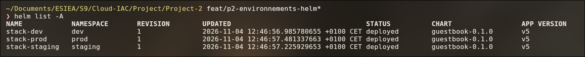

# Livre d'or Cloud

**Test de slides Marp**

Équipe Plateforme — ESIEA S9

---

## Une liste

- Un seul chart Helm
- 3 environnements : `dev`, `staging`, `prod`
- En local (minikube) et sur GKE

---

## Un tableau

| Env | Port | Disque |
|---|---|---|
| dev | 8080 | 1Gi |
| staging | 8081 | 1Gi |
| prod | 80 | 5Gi |

---

## Une commande

```bash
helm install stack-prod helm/guestbook -n prod \
  -f helm/guestbook/values-prod.yaml
```

---

## Une capture


